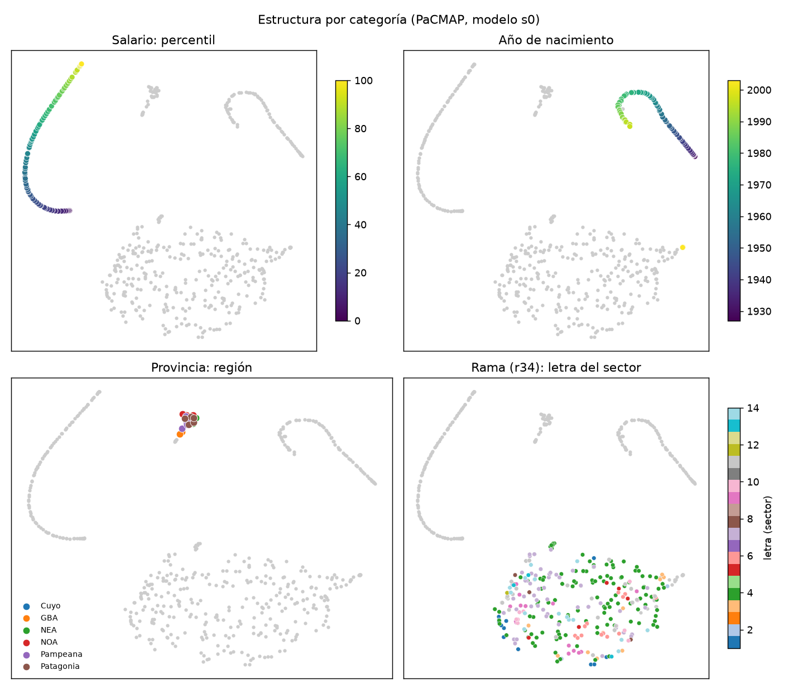
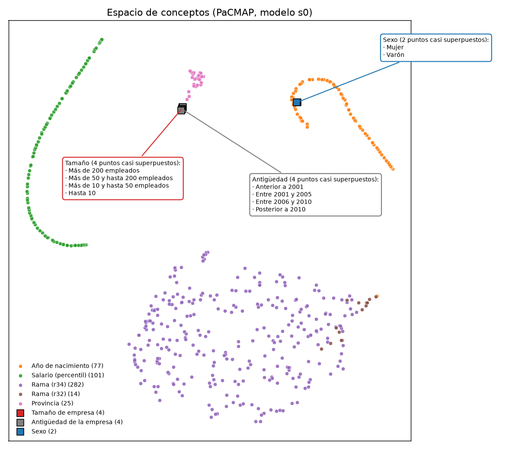
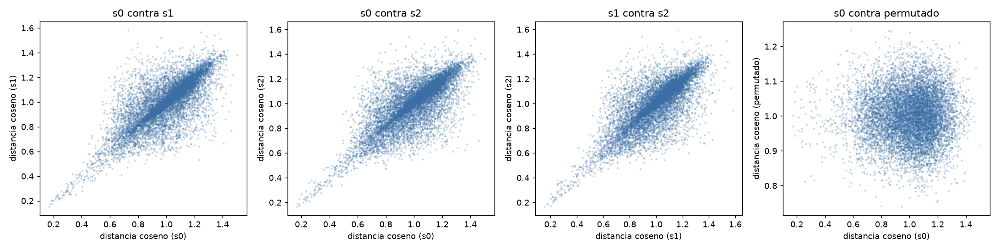
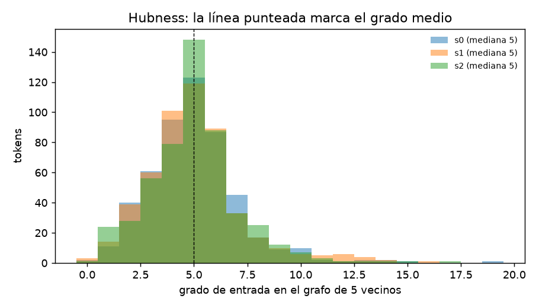

# Fase 5: evaluación del espacio de conceptos

Generado el 2026-10-20. Plan: [plans/PLAN_fase_5.md](../plans/PLAN_fase_5.md). Código: `src/labor2vec/analisis/`; se reproduce con `python -m labor2vec.analisis.conceptos` (unos 2,5 minutos en CPU). Las tablas completas, tal como las escribe el programa (con punto decimal), están en [fase5/resultados.md](fase5/resultados.md) y las figuras en [fase5/](fase5/).

## Qué se analizó

La matriz de embeddings de entrada de 509 tokens (los 519 del vocabulario menos los 10 especiales), centrada con la media de los tokens no especiales, de cuatro modelos:

- `s0`, `s1`, `s2`: 150 épocas con las semillas 0, 1 y 2 (perplejidad MLM 4,73 / 4,86 / 4,84).
- `ep30`: 30 épocas, semilla 0 (perplejidad MLM 6,36).

Todos los p-valores son empíricos de una cola, con 1.000 permutaciones de etiquetas por medida y 5.000 iteraciones en el test entre modelos, por lo que el valor mínimo posible es 0,001 y 0,0002 respectivamente. Las comparaciones de robustez llevan corrección de Benjamini-Hochberg.

## Resultados

### Variables ordinales

| Medida | s0 | s1 | s2 | ep30 |
|---|---|---|---|---|
| **Salario** (percentiles 1-100): proporción de los 4 vecinos a ≤ 5 percentiles (azar: 0,10) | **1,000** | **1,000** | **1,000** | **1,000** |
| Salario: Spearman entre la distancia coseno de cada par y \|Δpercentil\| | 0,84 | 0,83 | 0,84 | 0,83 |
| Salario: \|Spearman\| con la 1ª componente principal | 0,91 | 0,92 | 0,93 | 0,80 |
| **Año de nacimiento**: proporción de los 4 vecinos a ≤ 3 años (azar: 0,08) | **0,96** | **0,95** | **0,95** | 0,77 |
| Año de nacimiento: Spearman entre la distancia coseno de cada par y \|Δaño\| | 0,18 | 0,18 | 0,23 | **0,75** |
| Año de nacimiento: \|Spearman\| con la 1ª componente principal | 0,07 | 0,24 | 0,26 | 0,71 |
| Tamaño de empresa (4 niveles): Spearman distancia contra \|Δnivel\| | 0,83 | 0,83 | 0,83 | 0,83 |
| Antigüedad de la empresa (4 niveles): idem | 0,77 | 0,62 | 0,93 | 0,93 |

- **Los percentiles de salario salen ordenados en una curva**, como en el paper: en los cuatro modelos los 4 vecinos más cercanos de cualquier percentil son siempre percentiles a ≤ 5 puntos de distancia (el azar da 0,10), y la distancia coseno crece con la diferencia de percentil (0,83-0,84). `REM_000` (remuneración cero) tiene como vecinos a los percentiles más bajos (`REM_001` en los cuatro modelos, y `REM_002` o `REM_003`, `REM_004`, `REM_005`, `REM_007` según el modelo); en `ep30` aparece además `REM_094` entre sus tres vecinos más cercanos.
- **Los años de nacimiento están ordenados a nivel local en los modelos de 150 épocas** (95-96 % de los vecinos a ≤ 3 años, contra 8 % del azar), **pero la geometría global es otra**: la curva se dobla (la figura muestra una herradura), y por eso ni la primera componente (0,07-0,26) ni la distancia entre pares (0,18-0,23) crecen con la diferencia de años. El modelo de 30 épocas, con peor orden local (0,77), conserva mejor el orden global (0,75). No se puede decir con estos datos si la curvatura es una propiedad útil del modelo o un artefacto; el hallazgo se reporta tal cual.
- Con 4 niveles (tamaño de empresa y antigüedad) las medidas son indicativas y no tienen test de significancia.

### Pureza de vecindades

| Medida (vecinos más cercanos) | s0 | s1 | s2 | ep30 | Azar |
|---|---|---|---|---|---|
| Ramas (r34): pureza respecto de la letra, 5 vecinos | 0,41 | 0,39 | 0,39 | 0,41 | 0,22 |
| Ramas (r34): pureza respecto del r32, 5 vecinos | 0,14 | 0,12 | 0,14 | 0,14 | 0,03 |
| Provincias: pureza respecto de la región, 3 vecinos | 0,49 | 0,47 | 0,44 | 0,43 | 0,15 |

Todas con p = 0,001 (el mínimo posible). Las ramas vecinas comparten sector mucho más que el azar (casi el doble por letra y más de cuatro veces por r32), pero la mayoría de los vecinos de una rama no son de su misma letra. Las provincias vecinas comparten región en casi la mitad de los casos, el triple del azar; en el mapa las provincias forman un único grupo sin regiones separadas a simple vista, y la pureza es la medida que muestra la estructura. Ejemplos de vecinos (modelo `s0`; la tabla completa, con el nombre de cada vecino, está en [fase5/resultados.md](fase5/resultados.md)): `PROV_06` (Buenos Aires) tiene como vecinas más cercanas a `PROV_02` (CABA) y `PROV_01` (GBA); `RAMA_8000` (Enseñanza) a `RAMA_9100` (asociaciones) y `RAMA_8510` (salud); `RAMA_5521` (comidas y bebidas) a `RAMA_5512`, `RAMA_9309` y `RAMA_5522`. `TAM_1` (más de 200 empleados) tiene como vecinos `TAM_2`, `TAM_3` y `TAM_4` y luego `ANT_1` (empresas anteriores a 2001) y `PROV_02`. `SEXO_M` tiene como vecinos a `SEXO_V` y a varios años de nacimiento; una explicación posible, que no se probó, es que ambos tipos de token ocupan el bloque de fondo del documento.

Con los nombres a la vista se nota además que unas pocas ramas de servicios a empresas aparecen como vecinas de muchas otras: `RAMA_7010` (servicios inmobiliarios) figura entre los 5 vecinos de 5 de las 8 ramas de ejemplo, y `RAMA_7492` (investigación y seguridad) y `RAMA_7410` (servicios jurídicos y de contabilidad) también se repiten. Es consistente con el *hubness* de más abajo. Algunas vecindades son plausibles (comidas y alojamiento, transporte de pasajeros y de cargas, salud y farmacia) y otras no se explican a simple vista (`RAMA_8510` salud con `RAMA_7492` seguridad).

En el mapa 2D los diez tokens de **tamaño de empresa, antigüedad y sexo** caen casi en el mismo punto (los cuatro de tamaño y los cuatro de antigüedad prácticamente superpuestos, y los dos de sexo también), por eso en lugar de una etiqueta por punto el mapa trae una nota con flecha por categoría que lista todos sus niveles con su nombre. Esa superposición es de la proyección 2D de PaCMAP; en el mapa 3D se pueden ver mejor por separado, aunque tampoco se separan mucho.

### Mapas con nombres de ramas y visualización 3D

- [fase5/mapa_ramas.png](fase5/mapa_ramas.png): las ramas coloreadas por sector (izquierda) y con el nombre de las ramas más frecuentes (derecha). **No se rotula el centro de cada sector** porque los sectores no forman grupos compactos (la pureza por letra es 0,41): una etiqueta en el centro quedaría en una zona donde hay ramas de otros sectores. Sólo caben unas 24 etiquetas sin solaparse; para ver todas está el mapa interactivo.
- [fase5/mapa_ramas.html](fase5/mapa_ramas.html): mapa interactivo de las 296 ramas (282 finas y 14 agregadas a 2 dígitos); al pasar el cursor por un punto aparece el código, la descripción, el sector, la división y los eventos en train. No necesita conexión.
- [fase5/mapa_3d.html](fase5/mapa_3d.html): **espacio de conceptos en 3D** (PaCMAP con 3 componentes, modelo `s0`). Se rota y se acerca con el mouse y el cursor muestra el nombre y la descripción del token. **Un clic en un elemento de la leyenda resalta ese grupo y atenúa el resto** (por ejemplo, la rama «Agricultura y ganadería»); se pueden resaltar varios a la vez y otro clic sobre el mismo lo quita. Arriba del gráfico hay botones para resaltar una categoría entera, quitar el resaltado y una casilla para ocultar por completo lo no resaltado. Salarios con degradé por percentil, años de nacimiento con degradé por año, provincias por región, ramas por sector. La lógica del resaltado se probó con `node` y un entorno simulado (`tests/resaltar.test.js`); no se probó en un navegador real. **Necesita conexión a internet** para cargar la librería de gráficos (`plotly`) desde su CDN. La proyección 3D se ve coherente con la 2D (salarios y años en curvas, provincias en un grupo, ramas en una nube), pero el autor de PaCMAP advierte que los casos con más de 2 componentes están menos probados.

### Robustez entre semillas

| Comparación (509 tokens, Spearman entre las distancias coseno) | Spearman | p ajustado |
|---|---|---|
| s0 contra s1 | 0,725 | 0,0003 |
| s0 contra s2 | 0,724 | 0,0003 |
| s1 contra s2 | 0,731 | 0,0003 |
| s0 contra ep30 | 0,696 | 0,0003 |
| s0 contra columnas permutadas (nulo) | -0,001 | 0,69 |
| s0 contra gaussiano (nulo) | 0,002 | 0,34 |

| Por categoría | s0 contra s1 | s0 contra s2 | s1 contra s2 |
|---|---|---|---|
| Salario | 0,80 | 0,79 | 0,79 |
| Año de nacimiento | 0,86 | 0,74 | 0,85 |
| Rama (r34) | 0,37 | 0,40 | 0,40 |
| Provincia | 0,41 | 0,31 | 0,39 |

Las tres semillas comparten una estructura de distancias claramente distinta de cualquier nulo (Spearman 0,72-0,73; los nulos dan 0), y el modelo de 30 épocas se parece a los de 150 casi tanto como estos entre sí (0,70). La estructura se reproduce mucho mejor en las variables ordinales (0,74-0,86) que en las ramas (0,37-0,40) y las provincias (0,31-0,41): el orden de salarios y años es robusto, y las vecindades finas entre ramas son más específicas de cada entrenamiento.

### Hubness

| Medida (grafo de 5 vecinos, grado medio 5) | s0 | s1 | s2 | ep30 |
|---|---|---|---|---|
| Asimetría de la distribución del grado de entrada | 1,33 | 1,18 | 0,94 | 0,39 |
| Grado máximo | 19 | 16 | 17 | 12 |
| Tokens con grado 0 | 0,4 % | 0,6 % | 0,2 % | 1,0 % |

Casi todos los tokens aparecen como vecino de alguien (menos del 1 % con grado 0), así que no hay muchos tokens «aislados». Con más entrenamiento aparecen más tokens que funcionan como *hubs*: la asimetría pasa de 0,39 a 0,94-1,33. En `s0` los hubs más fuertes son los 14 tokens de rama a 2 dígitos `RAMA2_xx` (mediana 10, máximo 19, contra mediana 4 y máximo 14 de las 282 ramas de 4 dígitos), que agrupan ramas raras y por eso resultan «genéricos». No se comparó con el paper.

## Lo que se ve y lo que no

- **Se ve**: orden numérico local muy limpio en salarios y años de nacimiento, vecindades por sector y por región más fuertes que el azar, y una estructura compartida por las tres semillas.
- **Con reservas**: la geometría global de los años de nacimiento no es monótona; la pureza de las ramas es moderada (41 % por letra); las vecindades finas de ramas y provincias se reproducen sólo parcialmente entre semillas.
- **No se evaluó**: el espacio de personas, TCAV y saliency (fase 7), ni el valor del embedding en tareas de predicción (fase 6). PaCMAP es una visualización: las distancias en 2D no son cuantitativas y las medidas se calcularon en las 280 dimensiones.
- Los p-valores están acotados por el número de permutaciones y no se corrigieron por las ~15 medidas por modelo; las conclusiones descansan sobre diferencias grandes respecto del azar, no sobre p-valores marginales.
