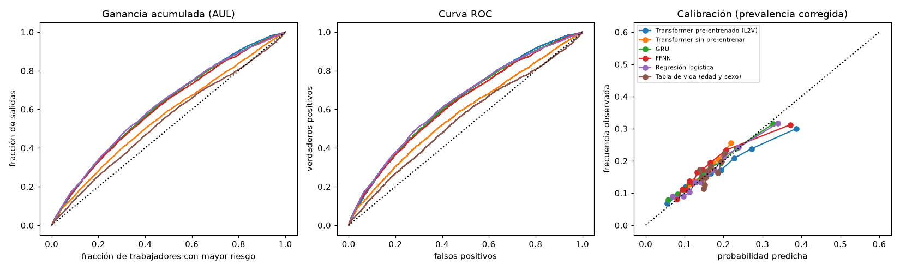

# Fase 6: ajuste fino de T1 (salida del empleo registrado) y líneas de base

Plan: [plans/PLAN_fase_6.md](../plans/PLAN_fase_6.md). Fecha: 2026-10-20.

## Resumen

- Se ajustó el transformer pre-entrenado (`pre_150ep`) para predecir si un trabajador **sale del empleo registrado**, y se lo comparó con cinco líneas de base sobre el mismo test.
- **El pre-entrenamiento aporta mucho**: el mismo transformer sin pre-entrenar queda en AUL 0,563 contra **0,619** con pre-entrenamiento. Los intervalos de confianza no se tocan.
- **Contra los modelos con historia laboral no hay diferencia demostrable**: transformer pre-entrenado (0,619), GRU (0,616), regresión logística (0,617) y FFNN (0,608) tienen intervalos que se solapan por completo. A diferencia del paper, donde el transformer le saca más de 0,10 de AUL a la logística, acá la ventaja prácticamente desaparece.
- La **señal de T1 es débil**: el mejor modelo llega a AUC 0,64. Edad y sexo solos dan 0,545 y la historia laboral agrega ~0,10.
- Con la etiqueta de 2021 (prueba extra, sin reentrenar) el orden y las distancias son los mismos.

## 1. Tarea, cohorte y etiquetas

| | |
|---|---|
| Cohorte | 25 a 55 años al 31-12-2015 y los 12 meses de 2015 registrados: **122.492** trabajadores |
| Splits (los de la fase 1) | train 85.852, validación 18.303, test 18.337 |
| Entrada del modelo | historia hasta 2015-12 (la misma ventana del pre-entrenamiento); nunca ve datos posteriores |
| Etiqueta principal `y_2019` | 1 si no tiene **ningún mes registrado en 2019** (a 4 años del corte). Tasa 16,0 % (16,5 % en test) |
| Prueba extra `y_2021` | 1 si no tiene ningún mes registrado en 2021, con el mismo modelo sin reentrenar. Tasa 22,8 % |

Salen más las mujeres (18,8 % contra 14,6 %) y los de 25 a 34 años (17,8 %). Se calculan con `python -m labor2vec.tareas.t1`. Las tasas casi no varían entre splits.

"No aparecer en la muestra" mezcla causas (informalidad, desempleo, empleo público, cuentapropismo, jubilación, emigración, muerte). Es una etiqueta observada pero ambigua: lo que se predice es la salida del empleo asalariado registrado privado, no el desempleo.

## 2. Modelos

| Modelo | Qué es |
|---|---|
| Transformer pre-entrenado (L2V) | `pre_150ep` más la cabeza del original (*pooling* por atención y capa lineal), pérdida de entropía cruzada balanceada, RAdam con tasa por capa y decaimiento por época, embeddings de conceptos congelados salvo [CLS], [SEP] y [UNK]. **lr 0,001**, lote efectivo 64, épocas de 9.600 secuencias, parada temprana por AUL de validación (paciencia 5) |
| Transformer sin pre-entrenar | El mismo transformer y el mismo ajuste, con pesos al azar |
| GRU | Bidireccional, 3 capas, 256 de ancho, dropout 0,27, mismos embeddings de token, posición, edad y segmento, misma cabeza, sin pre-entrenar, lr 0,001 |
| FFNN | 3 bloques de 646, dropout 0,35, sobre la proporción de cada token más sexo y edad, lr 1,7e-4 |
| Regresión logística | L2, clases balanceadas, mismas entradas que la FFNN estandarizadas |
| Tabla de vida | Regresión logística sólo con sexo y edad |

Todos usan las mismas clases balanceadas en el entrenamiento (muestreo 50/50), así que sus probabilidades son comparables. Para L2V, GRU y FFNN se entrenaron **3 semillas**; para el transformer sin pre-entrenar, la regresión logística y la tabla de vida, una.

Detalles que se apartan del repo original de life2vec:

- **lr 0,001 en lugar de 0,01.** Se eligió por AUL de validación entre 0,01 (0,602), 0,003 (0,600) y 0,001 (0,609) con la semilla 0. Las diferencias están dentro del ruido de una semilla.
- La **pérdida "asimétrica PU"** del paper es, en el código original, una entropía cruzada balanceada. Es la que se implementó. Como acá la etiqueta es observada, no hace falta corregir por casos no etiquetados.
- El original nunca aplica *weight decay* al encoder (error en su código); acá se mantiene ese efecto (0 en el encoder, 0,01 en la cabeza).
- El GRU de la semilla 2 llegó al límite de 1 h en la partición `short` y se **reanudó** desde su checkpoint con el mismo comando; terminó en 5 min más.

## 3. Resultados en test, etiqueta `y_2019`

AUL y AUC: 0,5 es el azar y 1 sería perfecto. Los intervalos son bootstrap estratificado de 1.000 réplicas (95 %); los modelos con 3 semillas muestran el IC de la media entre semillas. Umbral 0,5 para las medidas corregidas.

| Modelo | Sem. | AUL | AUC | PR-AUC | C-MCC |
|---|---|---|---|---|---|
| **Transformer pre-entrenado (L2V)** | 3 | **0,619** [0,610; 0,627] | 0,642 [0,631; 0,652] | 0,257 | 0,143 [0,131; 0,156] |
| Regresión logística | 1 | 0,617 [0,608; 0,626] | 0,640 [0,629; 0,651] | 0,258 | 0,159 [0,144; 0,174] |
| GRU | 3 | 0,616 [0,606; 0,625] | 0,638 [0,627; 0,649] | 0,259 | 0,146 [0,133; 0,160] |
| FFNN | 3 | 0,608 [0,600; 0,617] | 0,630 [0,619; 0,641] | 0,253 | 0,147 [0,131; 0,162] |
| Transformer sin pre-entrenar | 1 | 0,563 [0,553; 0,573] | 0,575 [0,564; 0,587] | 0,221 | 0,091 [0,076; 0,106] |
| Tabla de vida (edad y sexo) | 1 | 0,538 [0,527; 0,547] | 0,545 [0,533; 0,556] | 0,192 | 0,056 [0,040; 0,071] |
| Azar | 1 | 0,499 [0,489; 0,509] | 0,499 | 0,165 | −0,006 |
| Mayoría | 1 | 0,500 | 0,500 | 0,165 | 0,000 |

La prevalencia en test es 0,165, que es el PR-AUC del azar. Tabla completa, con F1 y exactitud corregidas, en [fase6/tabla_y2019.md](fase6/tabla_y2019.md).

- **Entre semillas** la variación del AUL es chica: desvío 0,005 en L2V, 0,003 en el GRU y 0,001 en la FFNN.
- **C-MCC:** con etiquetas observadas (α = 0, β = 1) el C-MCC corregido es el MCC común. En C-MCC la regresión logística (0,159) queda algo por encima de los demás, aunque los intervalos se tocan con los de la FFNN y el GRU.

### Prueba extra: etiqueta `y_2021`

| Modelo | AUL | AUC | C-MCC |
|---|---|---|---|
| Transformer pre-entrenado (L2V) | 0,613 [0,607; 0,620] | 0,647 | 0,171 |
| GRU | 0,609 [0,602; 0,616] | 0,641 | 0,169 |
| Regresión logística | 0,607 [0,599; 0,614] | 0,639 | 0,176 |
| FFNN | 0,600 [0,593; 0,607] | 0,630 | 0,165 |
| Transformer sin pre-entrenar | 0,566 [0,558; 0,574] | 0,586 | 0,118 |
| Tabla de vida | 0,527 [0,520; 0,536] | 0,535 | 0,063 |

Los mismos modelos, sin reentrenar, mantienen su AUL contra una etiqueta a 6 años que incluye el shock del COVID. Detalle en [fase6/tabla_y2021.md](fase6/tabla_y2021.md).

## 4. Subgrupos y calibración

AUL en test por subgrupo, media entre semillas ([fase6/subgrupos.md](fase6/subgrupos.md)):

| Modelo | mujeres | varones | 25-34 | 35-44 | 45-55 |
|---|---|---|---|---|---|
| L2V | 0,611 | 0,620 | 0,612 | 0,633 | 0,611 |
| GRU | 0,615 | 0,612 | 0,616 | 0,635 | 0,607 |
| Regresión logística | 0,612 | 0,612 | 0,619 | 0,629 | 0,592 |
| FFNN | 0,607 | 0,601 | 0,611 | 0,618 | 0,581 |
| Tabla de vida | 0,531 | 0,509 | 0,543 | 0,558 | 0,484 |

- El rendimiento es parecido en mujeres y varones.
- Los de 45 a 55 años son el grupo más difícil para los modelos tabulares (la logística baja a 0,592 y la FFNN a 0,581); L2V y el GRU mantienen ~0,61. Es un grupo chico (4.552), así que es una pista y no una conclusión.

**Calibración** ([fase6/calibracion.md](fase6/calibracion.md), [fase6/curvas.png](fase6/curvas.png)): el Brier con las probabilidades llevadas a la prevalencia real queda entre 0,133 y 0,137 para todos, contra 0,1376 de predecir siempre la prevalencia. Las probabilidades casi no mejoran sobre la tasa base. En el tramo alto el transformer pre-entrenado **sobrestima** el riesgo (predice ~0,39 donde se observa ~0,30).



## 5. Qué aporta el pre-entrenamiento

| | AUL val | AUL test |
|---|---|---|
| Transformer pre-entrenado (media de 3 semillas) | 0,612 | 0,619 |
| Transformer sin pre-entrenar | 0,553 | 0,563 |

Es una diferencia de ~0,06 de AUL, con intervalos separados, con el mismo código, los mismos datos y el mismo lr. Los pesos aprendidos con MLM + SOP contienen casi toda la información útil de la historia laboral: el transformer sin pre-entrenar apenas supera a la tabla de vida.

La **sonda lineal** (encoder fijo, se entrena sólo la cabeza) llega a 0,591 de AUL de validación: el ajuste fino agrega ~0,02 sobre eso.

El GRU, que tampoco está pre-entrenado, llega a 0,616: la arquitectura recurrente aprende esta tarea sin ayuda, mientras que el transformer necesita el pre-entrenamiento.

## 6. Sensibilidad de hiperparámetros y ablaciones

AUL de validación, semilla 0, selección por validación (el test no participó en ninguna decisión):

| Variante | AUL val | Épocas | Comentario |
|---|---|---|---|
| lr 0,01 (el del original) | 0,602 | 14 | oscila bastante |
| lr 0,003 | 0,600 | 14 | |
| **lr 0,001 (elegido)** | **0,609** | 19 | |
| lr 0,0003 | 0,601 | 19 | no mejora |
| lr 0,001 con embeddings de conceptos descongelados | 0,613 | 19 | sin diferencia con el base |
| Sonda lineal (encoder fijo, lr 0,003) | 0,591 | 19 | |
| Sin pre-entrenar (lr 0,001) | 0,553 | 19 | |

Las tres semillas de L2V dan 0,609 / 0,614 / 0,613. Las variantes de lr y de congelamiento quedan dentro del ruido de una semilla (~0,005): no hay evidencia de que otro ajuste mejore. La pérdida de validación de L2V se queda en ~0,675, muy cerca de la de un modelo sin información (0,693), y la de entrenamiento baja a ~0,63: hay un sobreajuste leve al final.

## 7. Comparación con el paper (tabla A2, mortalidad en Dinamarca)

Sólo se puede comparar el orden y las distancias entre modelos, no los valores absolutos: la tarea, la población y las variables son otras.

| Modelo | Paper (AUL) | Acá (AUL) |
|---|---|---|
| L2V | 0,845 | 0,619 |
| GRU | 0,834 | 0,616 |
| FFNN | 0,822 | 0,608 |
| Regresión logística | 0,735 | 0,617 |
| Tabla de vida | 0,650 | 0,538 |

- En el paper hay una escalera: L2V > GRU > FFNN, y los tres muy por encima de la logística (+0,11). Acá L2V, GRU y la logística empatan.
- La tabla de vida es el piso en los dos casos.
- Una explicación posible es la riqueza de las entradas: el paper usa salud y trabajo con ~2.000 tokens y eventos diarios, y acá hay una sola fuente mensual con 519 tokens. Con menos información por evento, un modelo de conteos ya capta casi todo. Es una hipótesis, no un resultado de esta fase.

## 8. Limitaciones

- Los intervalos de confianza son **independientes y no pareados**: para afirmar que dos modelos difieren o no, convendría un bootstrap pareado de la diferencia (no se hizo).
- El transformer sin pre-entrenar, la regresión logística y la tabla de vida tienen **una sola semilla**.
- El AUL de validación se usó para elegir el lr y la época; el test se calculó una vez por modelo y no se usó para decidir.
- Las probabilidades salen de modelos entrenados con muestreo 50/50, por eso se corrigen por prevalencia para el Brier y la calibración; el C-MCC usa el umbral 0,5 sobre la probabilidad sin corregir, como el original.
- La etiqueta mezcla causas de salida (sección 1), y la antigüedad de la empresa, la rama y la provincia son atributos de "último valor" de la relación: el control sin esos atributos queda para la fase 8.
- No se probó una búsqueda sistemática de hiperparámetros ni se ajustaron los baselines tabulares más allá de la configuración del paper.

## 9. Reproducción

```
python -m labor2vec.tareas.t1                         # cohorte y etiquetas
python -m labor2vec.tareas.tabulares                  # tabla de vida, logística y FFNN (local)
sbatch scripts/cluster/ajustar.sbatch t1_l2v_lr0001_s0 configs/ajuste_t1.yaml --set ajuste.lr=0.001   # Mendieta
sbatch scripts/cluster/ajustar.sbatch t1_gru_s0 configs/gru_t1.yaml
python -m labor2vec.tareas.evaluar                    # tablas y figuras de informes/fase6/
```

Corridas: L2V `t1_l2v_lr0001`, `_s1`, `_s2`; sin pre-entrenar `t1_scratch_s0`; GRU `t1_gru_s0`, `_s1`, `_s2`; ablaciones `t1_abl_*`; sensibilidad de lr `t1_l2v_s0` (0,01) y `t1_l2v_lr0003`. En el cluster están en `~/labor2vec/runs/<nombre>/` y localmente (sin checkpoints) en `runs/<nombre>/`.

## 10. Pendiente

1. T2 a T4 (posición salarial futura, cambio de sector, transición de tamaño de empresa): subplan aparte.
2. Fase 7 (espacio de personas, TCAV y saliency) y fase 8 (ablaciones, incluyendo el control sin atributos "último valor", y el informe final).
3. Bootstrap pareado de las diferencias entre modelos y más semillas de los baselines de una sola corrida, si se quiere cerrar la comparación.
