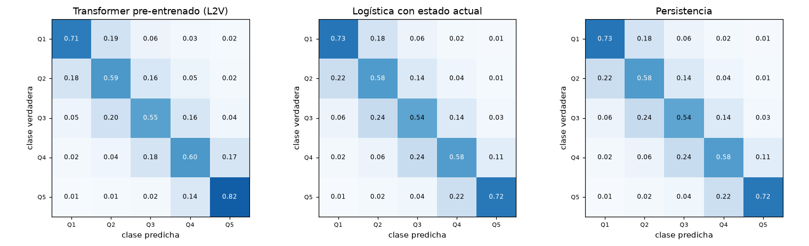
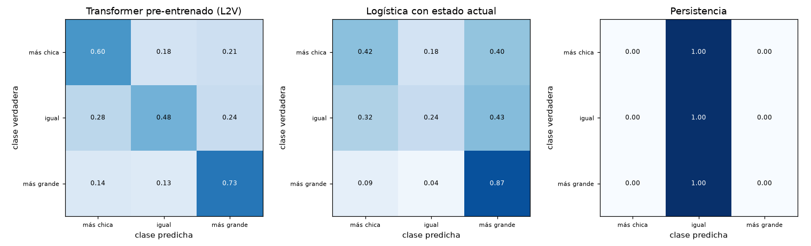

# Fase 6b: ajuste fino de T2, T3 y T4 y líneas de base

Plan: [plans/PLAN_fase_6b.md](../plans/PLAN_fase_6b.md). Fecha: 2026-10-21. Es la continuación de [fase6.md](fase6.md) (T1).

## Resumen

- Se ajustó el transformer pre-entrenado (`pre_150ep`) a tres tareas más del mismo registro y se lo comparó con las mismas líneas de base que en T1, más dos propias de estas tareas: la **persistencia** (repetir el estado de 2015) y una **regresión logística con el estado actual**.
- **A diferencia de T1, en T3 y T4 el transformer pre-entrenado se separa claramente de los demás modelos**, con intervalos de confianza que no se tocan. En T2 supera apenas a la persistencia y empata con el GRU.
- **El pre-entrenamiento aporta en las tres tareas**: el mismo transformer sin pre-entrenar pierde ~0,09 puntos de la métrica principal en T2, T3 y T4 (en T1 perdía 0,06).
- **El GRU queda segundo**: empata con el transformer en T2 y queda por debajo en T3 (AUL 0,702 contra 0,725) y T4 (AUC macro 0,746 contra 0,772).
- **La pérdida ordinal del original (CDW + focal + suavizado) no aporta nada** frente a la entropía cruzada balanceada común, en T2 ni en T4.

## 1. Tareas, cohorte y etiquetas

Población: los **102.885 trabajadores de la cohorte de T1 que siguen registrados en 2019** (84 % de 122.492). Los splits son los de la fase 1 (~72 mil train, ~15 mil validación y ~15 mil test). La entrada del modelo es la misma de T1: historia hasta 2015-12.

Estado de un trabajador en un año (2015 o 2019): la **relación principal**, la de más meses registrados en el año (desempate por mayor remuneración y luego por id), da la rama (`letra`) y el tamaño de empresa; el **nivel salarial** es el promedio del percentil salarial mensual (`pct_rem_mes`) sobre las filas con remuneración positiva. Se calcula con `python -m labor2vec.tareas.derivadas`.

| Tarea | Qué se predice | Clases | n (test) | Distribución |
|---|---|---|---|---|
| T2 | Quintil del nivel salarial de 2019 (ordinal; cortes ajustados sólo con train) | 5 | 15.250 | 20 % cada uno; repetir el quintil de 2015 acierta 63,2 % (correlación de niveles 0,84) |
| T3 | La rama de 2019 es distinta de la de 2015 | 2 | 15.316 | 11,3 % cambia |
| T4 | Tamaño de la empresa principal en 2019 respecto de 2015 (ordinal) | 3 | 15.317 | más chica 9,8 %, igual 81,0 %, más grande 9,3 % |

Exclusiones: T2 deja afuera a 451 trabajadores sin remuneración positiva en alguno de los dos años; T3, a 3 sin rama definida; T4, a ninguno.

## 2. Modelos

Los mismos de T1, con los ajustes de T1 (lr 0,001 elegido por validación entre 0,01, 0,003 y 0,001; no se reajustó por tarea):

| Modelo | Comentario |
|---|---|
| Transformer pre-entrenado (L2V) | 3 semillas. Cabeza de atención de T1 con `n_clases` salidas |
| Transformer sin pre-entrenar | 1 semilla |
| GRU | 3 semillas |
| FFNN | 3 semillas (proporción de cada token, sexo y edad) |
| Regresión logística (multinomial) | mismas entradas |
| **Logística con estado actual** | edad, sexo y el estado de 2015 (quintil salarial, rama o tamaño). Es una línea de base barata que ya incorpora la persistencia |
| **Persistencia** | T2: repite el quintil de 2015; T4: siempre «igual». En T3 equivale a la mayoría |
| Tabla de vida (edad y sexo), mayoría y azar | como en T1 |

Pérdidas y monitoreo (parada temprana por la métrica de validación, paciencia 5):

- **T3 (binaria):** entropía cruzada balanceada, igual que T1; monitor `val/aul`.
- **T2 y T4 (ordinales):** la pérdida del original: 0,3 · CDW-CE + 1 · *focal* (γ = 2) + 0,1 · suavizado de etiquetas. El paper y el código original no coinciden en estos valores (exponente, γ y pesos fijos contra ponderación adaptativa) y no se pudo verificar cuál produjo sus números; se usaron los pesos fijos del paper con las fórmulas del código. Monitor `val/qwk` en T2 y `val/auc_macro` en T4.
- Muestreo balanceado por clase en el entrenamiento, así que las probabilidades salen sesgadas hacia las clases chicas; por eso las métricas principales de T4 son las que no dependen de un umbral.

Todos los jobs terminaron normalmente (ninguno se cortó por tiempo). La validación de las semillas es consistente: L2V T2 QWK 0,827 / 0,827 / 0,831; T3 AUL 0,715 / 0,708 / 0,711; T4 AUC macro 0,766 / 0,767 / 0,768.

## 3. Resultados en test

Los intervalos son bootstrap estratificado por clase de 1.000 réplicas (95 %); los modelos con 3 semillas muestran el IC de la media entre semillas. Tablas completas en `informes/fase6b/t{2,3,4}/`.

### T2, quintil salarial de 2019

QWK: 1 = acuerdo perfecto, 0 = el del azar. La clase predicha es la más probable.

| Modelo | Sem. | QWK | MAE | F1 macro | AUC macro |
|---|---|---|---|---|---|
| **Transformer pre-entrenado (L2V)** | 3 | **0,830** [0,824; 0,837] | 0,439 | 0,655 | 0,890 [0,886; 0,893] |
| GRU | 3 | 0,828 [0,821; 0,835] | 0,437 | 0,658 | 0,887 |
| Persistencia (= logística con estado actual) | 1 | 0,822 [0,816; 0,829] | 0,465 | 0,632 | 0,769 / 0,854 |
| FFNN | 3 | 0,765 [0,757; 0,773] | 0,567 | 0,576 | 0,849 |
| Regresión logística | 1 | 0,758 [0,751; 0,767] | 0,566 | 0,587 | 0,853 |
| Transformer sin pre-entrenar | 1 | 0,745 [0,737; 0,753] | 0,629 | 0,527 | 0,822 |
| Tabla de vida | 1 | 0,136 | 1,677 | 0,192 | 0,546 |
| Azar | 1 | −0,018 | 1,621 | 0,197 | 0,501 |

(La persistencia y la logística con estado actual predicen la misma clase, por eso tienen el mismo QWK; difieren en el AUC macro: 0,769 con la clase repetida y 0,854 con las probabilidades de la logística.)

- **L2V y GRU empatan** y superan por poco a la persistencia (QWK +0,008 y +0,006; los intervalos casi se tocan). Es una tarea donde repetir el quintil de 2015 ya da 0,82: el techo es alto y el margen de mejora, chico.
- **Donde se nota la diferencia es entre quienes cambian de quintil** (n = 5.641, 37 % del test):

| Modelo | Cambian: QWK / MAE | Se mantienen: QWK / MAE |
|---|---|---|
| L2V | 0,480 / 1,03 | 0,977 / 0,09 |
| GRU | 0,476 / 1,01 | 0,974 / 0,10 |
| Persistencia | 0,396 / 1,26 | 1,000 / 0,00 |
| FFNN | 0,459 / 1,01 | 0,900 / 0,31 |
| Sin pre-entrenar | 0,448 / 1,02 | 0,877 / 0,40 |

  Entre los que se mantienen, el transformer acierta casi tanto como la persistencia (0,977 contra 1,000). Entre los que cambian, el error medio baja de 1,26 quintiles (persistencia) a 1,03, pero sigue siendo alto: predecir adónde se mueve un salario es difícil y el MAE de L2V es parecido al de los demás modelos.
- **El pre-entrenamiento aporta ~0,085 de QWK** (0,830 contra 0,745).
- Subgrupos (QWK): mujeres 0,824, varones 0,828; por edad, 0,798 a los 25-34, 0,839 a los 35-44 y 0,858 a los 45-55 (frente a la logística con estado actual, que predice igual que la persistencia, L2V queda arriba en todos los grupos: 0,824 contra 0,808 en mujeres, 0,828 contra 0,824 en varones, 0,798 contra 0,778, 0,839 contra 0,836 y 0,858 contra 0,857 por edad).



### T3, cambio de sector

AUL y AUC: 0,5 es el azar. La prevalencia en test es 0,11 (es el PR-AUC del azar).

| Modelo | Sem. | AUL | AUC | PR-AUC | C-MCC |
|---|---|---|---|---|---|
| **Transformer pre-entrenado (L2V)** | 3 | **0,725** [0,715; 0,736] | 0,753 | 0,278 | 0,244 [0,231; 0,260] |
| GRU | 3 | 0,702 [0,691; 0,713] | 0,727 | 0,248 | 0,208 |
| FFNN | 3 | 0,687 [0,677; 0,699] | 0,710 | 0,227 | 0,179 |
| Regresión logística | 1 | 0,685 [0,673; 0,697] | 0,708 | 0,233 | 0,192 |
| Logística con estado actual | 1 | 0,656 [0,644; 0,667] | 0,675 | 0,199 | 0,158 |
| Transformer sin pre-entrenar | 1 | 0,639 [0,627; 0,652] | 0,656 | 0,188 | 0,140 |
| Tabla de vida | 1 | 0,615 | 0,629 | 0,162 | 0,120 |
| Azar / Mayoría | 1 | 0,510 / 0,500 | 0,512 / 0,500 | 0,116 / 0,110 | 0,007 / 0 |

- **L2V queda por encima de todos y su intervalo no toca los del resto**: +0,023 sobre el GRU y +0,038 sobre la FFNN y la logística.
- **El pre-entrenamiento aporta ~0,086 de AUL** (0,725 contra 0,639); sin pre-entrenar está cerca de la tabla de vida.
- Subgrupos (AUL): mujeres 0,747, varones 0,714; por edad, 0,683 a los 25-34, 0,718 a los 35-44 y 0,750 a los 45-55. Los más jóvenes son los más difíciles aunque son los que más cambian (16 %).
- Detalle en `informes/fase6b/t3/` (curvas de ganancia, ROC y calibración).

### T4, tamaño de empresa (más chica / igual / más grande)

Con una clase que domina (81 % «igual») conviene mirar medidas sin umbral: el AUC macro es el promedio de los AUC uno-contra-resto de las tres clases.

| Modelo | Sem. | AUC macro | QWK | Exact. balanc. | AUC «más chica» | AUC «más grande» |
|---|---|---|---|---|---|---|
| **Transformer pre-entrenado (L2V)** | 3 | **0,772** [0,767; 0,779] | **0,227** | 0,598 | 0,736 | 0,829 |
| GRU | 3 | 0,746 [0,740; 0,752] | 0,190 | 0,561 | 0,726 | 0,793 |
| FFNN | 3 | 0,692 [0,684; 0,700] | 0,111 | 0,496 | 0,669 | 0,718 |
| Regresión logística | 1 | 0,691 [0,682; 0,699] | 0,129 | 0,508 | 0,662 | 0,722 |
| Transformer sin pre-entrenar | 1 | 0,686 [0,682; 0,691] | 0,120 | 0,480 | 0,618 | 0,768 |
| Logística con estado actual | 1 | 0,684 [0,679; 0,689] | 0,154 | 0,512 | 0,616 | 0,771 |
| Tabla de vida | 1 | 0,580 | 0,019 | 0,388 | 0,562 | 0,592 |
| Persistencia / Mayoría | 1 | 0,500 | 0,000 | 0,333 | 0,500 | 0,500 |

- **L2V queda por encima de todos**: +0,026 de AUC macro sobre el GRU y +0,08 sobre los modelos de conteos. El QWK es bajo en todos (0,23 el mejor): predecir la dirección de un cambio de tamaño es difícil.
- **El pre-entrenamiento aporta ~0,086 de AUC macro** (0,772 contra 0,686).
- **Predecir que la empresa será más grande es más fácil** (AUC 0,83) que más chica (0,74).
- Subgrupos (AUC macro): mujeres 0,770, varones 0,773; por edad 0,760, 0,760 y 0,789 (45-55).



## 4. Aporte del pre-entrenamiento y comparación entre tareas

Diferencia entre el transformer pre-entrenado (media de 3 semillas) y el mismo sin pre-entrenar (1 semilla), en la métrica principal de cada tarea:

| Tarea | Métrica | Pre-entrenado | Sin pre-entrenar | Diferencia |
|---|---|---|---|---|
| T1 | AUL | 0,619 | 0,563 | +0,056 |
| T2 | QWK | 0,830 | 0,745 | +0,085 |
| T3 | AUL | 0,725 | 0,639 | +0,086 |
| T4 | AUC macro | 0,772 | 0,686 | +0,086 |

Y el transformer pre-entrenado contra la mejor línea de base simple de cada tarea:

| Tarea | Mejor línea de base simple | L2V | Diferencia |
|---|---|---|---|
| T1 | regresión logística, AUL 0,617 | 0,619 | +0,002 (empate) |
| T2 | persistencia, QWK 0,822 | 0,830 | +0,008 (cerca del empate) |
| T3 | FFNN, AUL 0,687 | 0,725 | **+0,038** |
| T4 | regresión logística, AUC macro 0,691 | 0,772 | **+0,081** |

- **El pre-entrenamiento aporta en las cuatro tareas**, pero **la ventaja sobre un modelo simple sólo es clara en T3 y T4**, es decir donde la etiqueta depende de características de las empresas (rama y tamaño) a lo largo del tiempo. En T1 y T2 los baselines ya capturan casi todo.
- **El GRU**, sin pre-entrenar, iguala al transformer en T1 y T2 y queda segundo en T3 y T4 (diferencias de 0,02 a 0,03). Hay algo de lo que sabe el transformer pre-entrenado que el GRU no aprende solo con estos datos de entrenamiento.
- Por qué T3 y T4 se benefician más es una **hipótesis, no un resultado de esta fase**: una bolsa de tokens pierde el orden y el momento de los cambios de empresa, que es justo lo que predice un nuevo cambio. No se probó (por ejemplo, con un control que mezcle el orden de los eventos).

## 5. Ablación de la pérdida ordinal

Mismo L2V (semilla 0, lr 0,001), con entropía cruzada balanceada común en lugar de la pérdida ordinal:

| Tarea | Métrica (test) | Pérdida ordinal | Entropía cruzada balanceada |
|---|---|---|---|
| T2 | QWK | 0,830 | 0,821 |
| T4 | AUC macro | 0,773 | 0,778 |

En validación: T2 QWK 0,827 contra 0,821 y T4 AUC macro 0,766 contra 0,769. Las diferencias son del tamaño del ruido entre semillas (desvío de ~0,001 en AUC macro y ~0,01 en QWK de T4): **no hay evidencia de que la pérdida ordinal ayude**, y en T4 la común sale algo mejor. Como es una sola semilla, la conclusión es que no aporta, no que perjudique.

## 6. Comparación con el paper

El único análogo ordinal del paper es la tarea de personalidad (extraversión, 5 clases, QWK entre 0,11 y 0,23 contra ~0 del azar, con el transformer por encima del GRU en todos los ítems pero significativo sólo en dos de cuatro). **No es comparable en valores**: acá la señal de entrada es mucho mayor (T2 tiene un QWK de 0,83 porque la persistencia ya da 0,82). Sí coincide el orden entre modelos: el transformer pre-entrenado queda por encima del GRU, aunque en T2 sólo por 0,002 de QWK.

## 7. Limitaciones

- Los IC son **independientes y no pareados**: para afirmar que dos modelos difieren o no convendría un bootstrap pareado de la diferencia (no se hizo). En T2 y T1 los intervalos se solapan; en T3 y T4 las diferencias son lo bastante grandes como para que el resultado no dependa de eso.
- El transformer sin pre-entrenar, la regresión logística, la logística con estado actual y la tabla de vida tienen **una sola semilla**. En T2 el transformer sin pre-entrenar llegó al tope de 35 épocas (mejor en la 30), así que podría mejorar algo con más.
- Los atributos de **«último valor»** (rama, provincia y antigüedad de la empresa, constantes por relación) pueden dar información sobre cambios posteriores al corte. Afecta sobre todo a T3 y T4; el control sin esos atributos queda para la fase 8. Si el efecto fuera grande, bajaría la ventaja de T3 y T4.
- Las etiquetas dependen de reglas de definición (relación principal, nivel salarial como promedio de percentiles, cortes de quintiles con train). Una definición distinta (por ejemplo, la letra del último mes o el salario mediano) podría cambiar los números.
- Las probabilidades salen de modelos entrenados con muestreo balanceado, así que no están calibradas a la prevalencia real; en T2 y T4 no se evaluó calibración, y las métricas con umbral (QWK, exactitud balanceada, F1 macro) usan la clase más probable de esas probabilidades.
- No se ajustaron hiperparámetros por tarea (lr 0,001 fijo) ni se probaron variantes de la definición de T3 (destino de la rama) o T4 (cambio sí o no).

## 8. Reproducción

```
python -m labor2vec.tareas.derivadas                          # tablas t2, t3 y t4
python -m labor2vec.tareas.tabulares --tarea t2                # baselines tabulares (local); también t3 y t4
sbatch scripts/cluster/ajustar.sbatch t2_l2v_s0 configs/ajuste_t2.yaml --set semilla=0     # Mendieta; también t3 y t4
sbatch scripts/cluster/ajustar.sbatch t2_gru_s0 configs/gru_t2.yaml --set semilla=0
sbatch scripts/cluster/ajustar.sbatch t2_abl_perdida_s0 configs/ajuste_t2.yaml --set ajuste.perdida=balanceada
python -m labor2vec.tareas.evaluar --tarea t2                  # tablas y figuras de informes/fase6b/t2/
```

Corridas: `t{2,3,4}_l2v_s{0,1,2}`, `t{2,3,4}_gru_s{0,1,2}`, `t{2,3,4}_scratch_s0`, `t{2,4}_abl_perdida_s0` y los baselines en `runs/t{2,3,4}_tab/`. En el cluster están en `~/labor2vec/runs/<nombre>/` y localmente (sin checkpoints) en `runs/<nombre>/`.

## 9. Pendiente

1. Fase 7 (espacio de personas, TCAV y saliency) y fase 8 (ablaciones, incluyendo el control sin atributos «último valor», y el informe final).
2. Bootstrap pareado de las diferencias y más semillas de los baselines de una sola corrida, si se quiere cerrar la comparación.
3. Variantes de T3 (letra de destino) y T4 (cambio sí o no) y de T2 (cambio de quintil), que quedaron fuera de esta fase.
