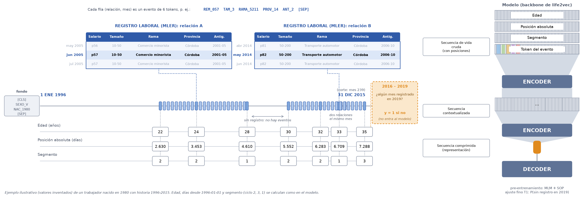
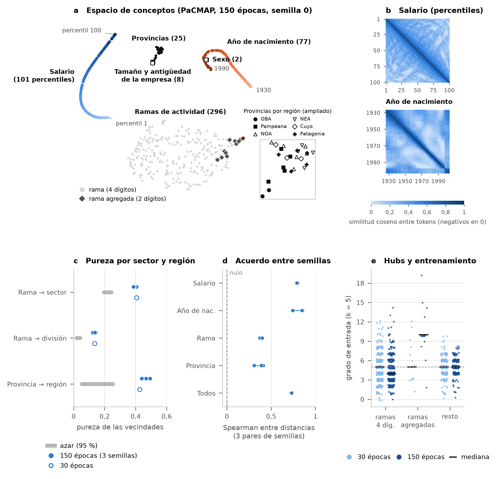
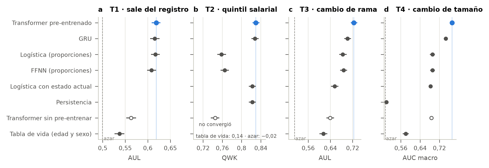
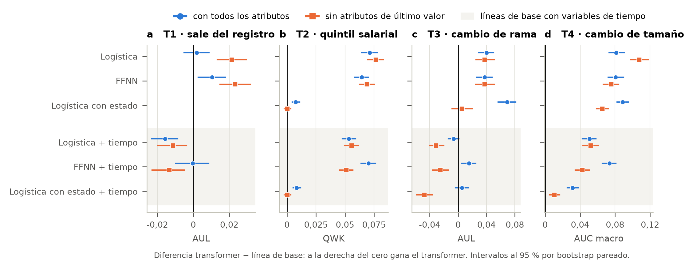
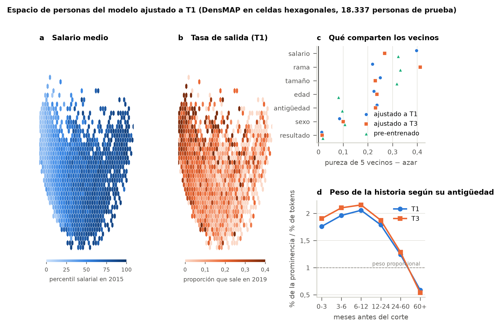
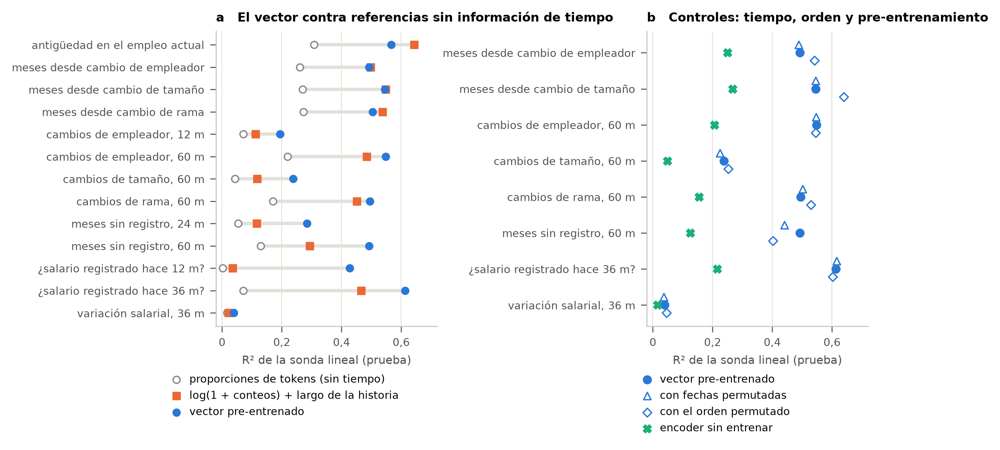
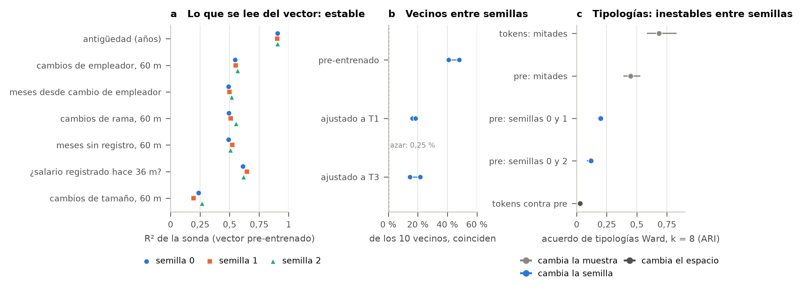
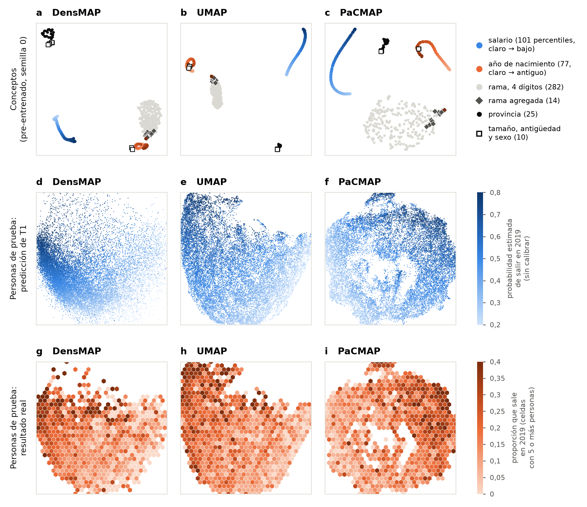

# Qué aprende un modelo de lenguaje de trayectorias laborales: pre-entrenamiento auto-supervisado sobre registros administrativos argentinos y los límites de su ventaja predictiva

**Versión preliminar (27 de octubre de 2026).** Autoría y filiaciones: [por completar].

---

## Resumen

Los modelos de secuencias de eventos de vida, como life2vec, proponen representar la biografía de una persona como un texto en un lenguaje sintético y aprender de él, mediante pre-entrenamiento auto-supervisado, representaciones útiles para predecir resultados individuales. La evidencia disponible proviene de registros nórdicos excepcionalmente ricos y de tareas en las que el modelo supera con holgura a sus comparadores. Este trabajo examina qué ocurre en un contexto más típico: registros administrativos de una sola fuente, a resolución mensual, de un país de ingreso medio. Adaptamos life2vec a la Muestra Longitudinal de Empleo Registrado de la Argentina (575.642 personas, 1996-2021), pre-entrenamos un transformer de 8,1 millones de parámetros sobre 344.025 historias laborales y lo evaluamos en cuatro tareas de predicción a cuatro años y en el análisis de sus espacios de representación. El pre-entrenamiento converge de manera estable entre semillas y produce un espacio de conceptos con estructura económica interpretable: los percentiles salariales forman una variedad ordenada, y las ramas de actividad y las provincias se agrupan por sector y región. En predicción, el modelo pre-entrenado iguala a una regresión logística y a una red recurrente en la salida del empleo registrado y en el nivel salarial, y las supera en el cambio de rama y de tamaño de empresa; el pre-entrenamiento aporta entre 0,06 y 0,09 puntos frente al mismo modelo sin pre-entrenar. Sin embargo, una batería de controles que el trabajo original no incluye (destrucción de la información temporal, ablación de atributos con posible fuga de información y líneas de base con variables temporales construidas a mano) reduce la ventaja a una sola tarea y a un margen de 0,01 a 0,03. El análisis con sondas lineales muestra que la información de dinámica que parecía distintiva de la representación aprendida es, en su mayor parte, información de cantidad recuperable de conteos de eventos, y que la geometría fina del espacio de personas no es reproducible entre semillas. Concluimos que la representación aprende estructura real del mercado de trabajo, pero que su valor predictivo depende críticamente de la tarea y de la fuerza de la línea de base, y proponemos un protocolo de controles para evaluar modelos de este tipo.

**Palabras clave:** trayectorias laborales; aprendizaje auto-supervisado; transformers; registros administrativos; life2vec; sondas lineales; Argentina.

---

## 1. Introducción

La disponibilidad creciente de registros administrativos longitudinales ha renovado el interés por predecir resultados individuales a partir de trayectorias de vida completas. Entre las propuestas recientes, life2vec (Savcisens et al., 2024) trata la biografía de cada persona como una secuencia de eventos con fecha, la escribe en un vocabulario sintético y entrena con ella un transformer del tipo BERT (Devlin et al., 2019) mediante dos tareas auto-supervisadas. El vector resultante se ajusta luego a tareas concretas. Sobre los registros daneses de salud y trabajo de seis millones de personas, el modelo superó a redes recurrentes, a redes densas y a una regresión logística en la predicción de mortalidad a cuatro años, y produjo espacios de conceptos y de personas interpretables. Modelos análogos se han propuesto para secuencias ocupacionales (Vafa et al., 2024).

Esos resultados plantean tres preguntas abiertas. La primera es de **transferibilidad**: los registros nórdicos combinan varias fuentes, resolución diaria y miles de tipos de eventos; la mayoría de los países dispone de registros de una sola fuente, más gruesos y con menos atributos por evento. No sabemos si la arquitectura y el esquema de pre-entrenamiento conservan su ventaja en ese contexto. La segunda es de **atribución**: cuando el modelo supera a sus comparadores, no está establecido si lo hace por explotar el orden y el momento de los eventos (la promesa de un modelo de secuencias), por resumir mejor información que también estaría disponible en variables simples, o por aprovechar información que no debería tener. La tercera es de **interpretación**: los espacios de representación se presentan como un insumo para las ciencias sociales, pero rara vez se compara lo que contienen con lo que contiene una representación trivial de los mismos datos, ni se verifica su estabilidad entre entrenamientos.

Este trabajo aborda las tres preguntas con una adaptación de life2vec, que llamamos **labor2vec**, a la Muestra Longitudinal de Empleo Registrado (MLER) de la Argentina. La MLER cubre el empleo asalariado registrado privado de una muestra del 3 % de los trabajadores, mes a mes, entre 1996 y 2021. Es una fuente rica en profundidad temporal (26 años) pero pobre en atributos: cada mes de cada relación laboral se describe por la remuneración, el tamaño, la rama de actividad, la provincia y la antigüedad de la empresa. Por eso es un caso de prueba exigente y representativo de los registros disponibles en buena parte del mundo.

Nuestras contribuciones son cuatro:

1. **Una adaptación abierta y documentada de life2vec a registros laborales de un país de ingreso medio**, con las diferencias respecto del código original verificadas y con validación exacta de los datos contra los cuadros oficiales.
2. **Una evaluación predictiva en cuatro tareas** (salida del empleo registrado, nivel salarial, cambio de rama y cambio de tamaño de empresa), con tres variantes adicionales, contra las líneas de base del trabajo original y dos propias de estas tareas (persistencia del estado y regresión con el estado actual).
3. **Un protocolo de controles para atribuir la ventaja predictiva**, ausente del trabajo original: destrucción de la información temporal con reajuste, ablación de los atributos con posible fuga de información, análisis por continuidad de la relación laboral, comparación con el mismo modelo sin pre-entrenar y líneas de base tabulares con variables temporales construidas a mano.
4. **Un análisis del espacio de personas con referencias explícitas**: sondas lineales comparadas con representaciones de conteos de tokens, controles de tiempo y orden, encoders sin entrenar, estabilidad entre semillas e intervenciones sobre la historia.

El resultado es deliberadamente mixto. La representación aprende estructura real y reproducible del mercado de trabajo, y el pre-entrenamiento es claramente útil frente al mismo modelo entrenado desde cero. Pero la ventaja sobre métodos simples se concentra en las tareas de movilidad entre empresas y, frente a líneas de base con variables temporales, sobrevive de manera consistente sólo en una de ellas. Del mismo modo, la mayor parte de la información de dinámica que las sondas leen de la representación es información de cantidad que un conteo de eventos también contiene. Sostenemos que estos resultados no restan valor al enfoque, sino que delimitan las condiciones en que su ventaja se sostiene y muestran que la elección de las líneas de base y de las referencias es, en esta literatura, una decisión sustantiva.

---

## 2. Trabajo relacionado

**Modelos de secuencias de vida.** life2vec (Savcisens et al., 2024) combina un encoder Performer (Choromanski et al., 2021) con incrustaciones de tiempo absoluto y edad, y lo pre-entrena con enmascarado de tokens (MLM) y predicción del orden de fragmentos (SOP, en la línea de Lan et al., 2020). Las líneas de base del trabajo original son la clase mayoritaria, el azar, una tabla de vida por edad y sexo, una regresión logística y una red densa sobre conteos de tokens por año, y una red recurrente con la misma entrada que el transformer. CAREER (Vafa et al., 2024) aplica una idea similar a secuencias de ocupaciones con datos de encuestas y currículums. Hasta donde sabemos, ninguno de estos trabajos contrasta el modelo con líneas de base que reciban variables temporales resumidas, ni controla la fuga de información a través de atributos medidos después del corte.

**Predictibilidad de trayectorias de vida.** El desafío de las familias frágiles (Salganik et al., 2020) mostró que, con cientos de equipos y miles de variables, los mejores modelos apenas superaban a una regresión simple con cuatro predictores. La lección, que modelos complejos y simples convergen cuando la señal es débil, es directamente relevante para nuestras tareas, cuya señal también es moderada.

**Fuga de información y reproducibilidad.** Kapoor y Narayanan (2023) documentan cómo la fuga de información entre entrenamiento y evaluación infla el rendimiento de modelos de aprendizaje automático en ciencia aplicada. En registros administrativos, una fuente frecuente de fuga son los atributos que el productor de los datos actualiza retroactivamente; la MLER tiene tres (sección 3.1).

**Interpretación de representaciones.** Las sondas lineales (Alain y Bengio, 2016) miden qué información se lee linealmente de una representación; su interpretación exige referencias y controles adecuados (Hewitt y Liang, 2019). Los vectores de activación de conceptos (TCAV; Kim et al., 2018) y los mapas de prominencia con ruido (SmoothGrad; Smilkov et al., 2017) son los métodos de interpretación que usa life2vec. La similitud entre representaciones de distintos entrenamientos se mide con el alineamiento de núcleos centrados (CKA; Kornblith et al., 2019). La concentración de vecindades en pocos puntos (*hubness*) es una patología conocida de los espacios de alta dimensión (Radovanović et al., 2010).

**Análisis de secuencias en sociología.** La tradición de análisis de secuencias con *optimal matching* (Abbott, 1995) y su extensión multicanal (Pollock, 2007) construye tipologías de trayectorias a partir de distancias entre secuencias. Un objetivo declarado de los modelos de secuencias de vida es ofrecer representaciones que sirvan a ese tipo de análisis; nuestro examen de la estabilidad del espacio de personas (sección 5.5) es pertinente para esa aspiración.

---

## 3. Datos

### 3.1 La Muestra Longitudinal de Empleo Registrado

La MLER es producida por el Ministerio de Trabajo, Empleo y Seguridad Social (MTEySS) a partir de registros administrativos. Contiene una fila por trabajador, relación laboral y mes para una muestra del 3 % de los asalariados registrados del sector privado: 49.193.201 filas, 596.591 trabajadores y 1.844.073 relaciones laborales, entre enero de 1996 y diciembre de 2021 (312 meses). Cada fila informa el sexo y el año de nacimiento del trabajador; la remuneración del mes; el tamaño de la empresa (cuatro tramos); la rama de actividad a cuatro dígitos; la provincia; y el tramo del año de inicio de actividades de la empresa (cuatro tramos, que llamamos *antigüedad de la empresa*).

**Validación.** Reproducimos de manera exacta los cuadros oficiales de empleo de la muestra: total mensual (312 meses), por sexo, por sector (4.368 celdas), por provincia y por rama a cuatro dígitos (1.199 celdas), con una única discrepancia de dos casos sin dato de tamaño en un mes. Los percentiles salariales oficiales se reproducen con error inferior al 0,01 %. La remuneración media queda entre 0,1 % y 1,5 % por debajo de la oficial, lo que atribuimos a la anonimización de los salarios altos por microagregación, que afecta a la media pero no a los percentiles.

**Tres limitaciones de la fuente** condicionan el diseño. (i) La rama, la provincia y la antigüedad de la empresa son atributos de *último valor*: el productor asigna a toda la relación laboral el valor del último registro disponible, de modo que un evento de 2010 puede llevar información posterior. (ii) La población es sólo el empleo asalariado registrado privado: la desaparición de una persona de la muestra mezcla informalidad, desempleo, empleo público, trabajo independiente, inactividad, jubilación, emigración y muerte. (iii) El dato de año de nacimiento se borra para quienes alguna vez superaron los 85 años, de modo que la exclusión de casos sin ese dato (sección 3.2) recorta historias largas de trabajadores mayores.

### 3.2 Población y particiones

Excluimos a los trabajadores sin sexo o sin año de nacimiento, lo que deja 575.642 personas. Las particionamos al azar a nivel de persona en entrenamiento (402.949), validación (86.347) y prueba (86.346). Todas las decisiones de modelado se tomaron con la partición de validación; la de prueba se usó una vez por modelo.

**Corte temporal.** Toda la información que ven los modelos termina en diciembre de 2015 (en adelante, *el corte*). La población de pre-entrenamiento son los 344.025 trabajadores de entrenamiento con al menos un evento hasta el corte.

### 3.3 Tareas de predicción

Las tareas usan la historia hasta el corte y una etiqueta medida en 2019, a cuatro años (Tabla 1).

**Tabla 1.** Tareas de predicción. La cohorte base son las personas de 25 a 55 años al 31-12-2015 con los doce meses de 2015 registrados. El *estado* de un año es el de la relación principal (la de más meses en el año); el nivel salarial es el promedio del percentil salarial mensual del año.

| Tarea | Pregunta | Población | n (prueba) | Distribución | Métrica principal |
|---|---|---|---|---|---|
| T1 | ¿Sale del empleo registrado (ningún mes registrado en 2019)? | 122.492 | 18.337 | 16,5 % sale | AUL |
| T2 | Quintil de nivel salarial en 2019 | 102.885 (siguen registrados en 2019) | 15.250 | 20 % por clase | QWK |
| T3 | ¿Cambia la rama (sector) entre 2015 y 2019? | ídem | 15.316 | 11,3 % cambia | AUL |
| T4 | Tamaño de la empresa en 2019 respecto de 2015 (menor, igual, mayor) | ídem | 15.317 | 9,8 / 81,0 / 9,3 % | AUC macro |
| T2c | Variante de T2: baja, mantiene o sube de quintil | ídem | 15.250 | | AUC macro |
| T3d | Variante de T3: sector de destino entre quienes cambian (6 clases) | quienes cambian | 1.683 | | AUC macro |
| T4c | Variante de T4: ¿cambia el tamaño? | ídem | 15.317 | 19,1 % cambia | AUL |

T1 ocupa el lugar de la mortalidad en el trabajo original. Es una etiqueta observada pero ambigua por la razón (ii) de la sección 3.1: predice la salida del empleo asalariado registrado privado, no el desempleo. Como prueba adicional, evaluamos los modelos de T1 sin reentrenar contra la etiqueta de 2021 (22,8 % de salida), que incluye el impacto de la pandemia.

---

## 4. Métodos

### 4.1 La historia laboral como documento

Cada mes de cada relación laboral es un *evento*, escrito como una oración de cinco tokens seguida de un separador `[SEP]`: percentil salarial del mes (`REM_001` a `REM_100`, más `REM_000` para remuneración nula), tamaño de la empresa, rama, provincia y antigüedad de la empresa. El salario se expresa como percentil dentro de cada mes, calculado sólo con la partición de entrenamiento; esto neutraliza la inflación sin depender de un índice de precios, que en la Argentina no es confiable para parte del período. Las ramas con menos de 50 trabajadores en entrenamiento se reemplazan por su agregado a dos dígitos. El documento comienza con un bloque de fondo con el sexo y el año de nacimiento. El vocabulario tiene 519 tokens (Figura 1).

A cada token se le suman tres incrustaciones además de la propia: el tiempo absoluto (días desde el 1-1-1996), la edad de la persona en ese momento y un indicador de segmento que alterna entre eventos, como en el código original. El modelo no tiene posición por índice: el orden de los eventos sólo le llega a través de la fecha y la edad. Los documentos de la cohorte de entrenamiento tienen una mediana de 268 tokens hasta el corte (percentil 99: 1.456); el 0,12 % supera el máximo de 2.560 y se trunca.

**Figura 1.** Esquema de labor2vec: de los registros mensuales al documento de la persona, el pre-entrenamiento y el ajuste fino.

### 4.2 Modelo y pre-entrenamiento

Usamos el encoder de life2vec sin modificaciones de arquitectura: cinco capas Performer con normalización ReZero, dimensión 280, 10 cabezas de atención (7 locales con ventana de 38 tokens y 3 globales con 436 atributos aleatorios), y 8,1 millones de parámetros con nuestro vocabulario. El pre-entrenamiento combina MLM (30 % de los tokens) y SOP con tres clases (orden normal, invertido o mezclado, en proporciones 90/5/5, con pesos de clase 1,1/10/10), con pesos 0,8 y 0,2 en la pérdida y suavizado de etiquetas de 0,1. Como aumentación aplicamos ruido temporal de ±15 días y la eliminación aleatoria de tokens. Entrenamos con precisión bf16 (validada contra fp32), lote efectivo de 64, calendario OneCycle con tasa máxima de 5·10⁻³ y recorte del gradiente en 1,0, durante 150 épocas de 375 pasos (3,6 millones de secuencias, unas diez pasadas por los datos; unas cinco horas en una GPU A30). Entrenamos tres modelos con semillas distintas y uno de 30 épocas para estudiar el efecto del entrenamiento.

Las diferencias con el código original son el orden de los tokens dentro del evento (fijo aquí; aleatorio en el original), la amplitud del ruido temporal (±15 días por la granularidad mensual, contra ±5) y la eliminación de tokens (10 % de los tokens por documento, contra un token por evento). Las verificamos contra el repositorio completo de life2vec.

### 4.3 Ajuste fino

Para cada tarea agregamos la cabeza del original (*pooling* por atención y capa lineal) y ajustamos todo el encoder salvo las incrustaciones de conceptos, con RAdam, tasa por capa con decaimiento y parada temprana por la métrica de validación (paciencia 5). La tasa de aprendizaje (10⁻³) se eligió en T1 por validación y se mantuvo en las demás tareas. En las tareas binarias usamos entropía cruzada balanceada (la «pérdida asimétrica» del trabajo original se reduce a ella cuando la etiqueta es observada); en las ordinales, la combinación del original de entropía cruzada ponderada por distancia, pérdida focal y suavizado, que en una ablación no superó a la entropía cruzada balanceada. Ajustamos tres semillas por tarea a partir del modelo pre-entrenado de semilla 0.

### 4.4 Líneas de base

- **Transformer sin pre-entrenar:** misma arquitectura y ajuste, con pesos aleatorios.
- **GRU:** red recurrente bidireccional de 3 capas y ancho 256, con las mismas incrustaciones de entrada y la misma cabeza (3 semillas).
- **FFNN y regresión logística** sobre la proporción de cada token en el documento más sexo y edad (la FFNN con la configuración del original; 3 semillas).
- **Logística con el estado actual:** edad, sexo y el estado de 2015 en la variable de la tarea (quintil, rama o tamaño).
- **Persistencia** (repetir el estado de 2015), **tabla de vida** (logística con edad y sexo), **mayoría** y **azar**.
- **Líneas de base con variables temporales** (control de la sección 4.6): logística y FFNN sobre conteos de tokens, y logística con el estado actual, cada una con 20 variables temporales calculadas de la historia hasta el corte: antigüedad en la relación principal; meses desde el último cambio de empleador, de tamaño y de rama; número de esos cambios en los últimos 12, 24 y 60 meses; meses sin registro en los últimos 24 y 60 meses; y variación del percentil salarial a 12 y 36 meses.

Todos los modelos se entrenan con muestreo balanceado de clases, de modo que sus probabilidades son comparables entre sí.

### 4.5 Evaluación

Seguimos las métricas del trabajo original. Para tareas binarias usamos el área bajo la curva de *lift* (AUL), que con etiquetas observadas es una transformación afín del AUC, $\mathrm{AUL} = \pi/2 + (1-\pi)\,\mathrm{AUC}$, con $\pi$ la prevalencia; informamos también el AUC, el área bajo la curva de precisión y exhaustividad, y el coeficiente de correlación de Matthews (que con etiquetas observadas coincide con el C-MCC del original). Para tareas ordinales usamos el kappa con ponderación cuadrática (QWK) y el AUC macro (promedio de los AUC uno contra el resto). Los intervalos de confianza al 95 % salen de 1.000 réplicas bootstrap estratificadas sobre las personas de prueba; las diferencias entre modelos del protocolo de controles son **pareadas** (mismas personas en cada réplica). Para los modelos con tres semillas informamos la media entre semillas.

### 4.6 Protocolo de controles

1. **Tiempo destruido.** Permutamos las fechas y edades entre los eventos de cada persona (el contenido queda en su lugar) y, por separado, el orden de los eventos llevándose su fecha. Evaluamos los modelos ajustados con la entrada alterada y, en T3 y T4, los reajustamos con el tiempo destruido; sólo el reajuste mide la dependencia real, porque el modelo puede aprender a prescindir de la información.
2. **Sin atributos de último valor.** Pre-entrenamos un modelo nuevo sin rama, provincia ni antigüedad de la empresa y reajustamos todos los modelos y líneas de base sin ellos. La caída es una cota superior de la fuga, porque esos atributos también contienen información legítima.
3. **Continuidad.** Separamos a las personas cuya relación principal terminó antes del corte, que no pueden tener fuga por último valor.
4. **Pre-entrenamiento.** Comparamos con el mismo transformer sin pre-entrenar.
5. **Variables temporales.** Comparamos con las líneas de base con variables temporales de la sección 4.4.

Los controles 2 a 5 no figuran en el trabajo original; el control 1 tiene allí sólo un análogo como aumentación.

### 4.7 Análisis de las representaciones

**Espacio de conceptos.** Analizamos la matriz de incrustaciones de entrada de los 509 tokens no especiales, centrada, en los cuatro modelos pre-entrenados. Medimos el orden de las variables ordinales (fracción de vecinos cercanos con valores próximos y correlación de Spearman entre distancia coseno y diferencia de valor), la pureza de las vecindades de ramas y provincias respecto de su sector y región, la reproducibilidad entre semillas (Spearman entre las matrices de distancias, con nulos de columnas permutadas y gaussianos) y la *hubness*. Los p-valores son empíricos, con 1.000 permutaciones de etiquetas y corrección de Benjamini-Hochberg en las comparaciones entre modelos.

**Espacio de personas.** Representamos a cada persona de validación y prueba por el promedio de la última capa del encoder pre-entrenado (`pre`) o por la salida del *pooling* de los modelos ajustados a T1 y T3. Aplicamos los métodos del original (proyección DensMAP y PaCMAP, TCAV y SmoothGrad) y, dado que TCAV resultó degenerado (sección 5.4), un análisis con **sondas lineales**: regresión ridge para variables continuas y logística multinomial para categóricas, entrenadas en validación y evaluadas en prueba, con la penalización elegida por validación cruzada. Las sondas buscan nueve atributos estáticos de 2015 y 19 variables de dinámica (las de la sección 4.4, salvo una que es constante en la cohorte), ninguna de las cuales fue etiqueta de entrenamiento. Las comparamos con **referencias** que no contienen información temporal: proporciones de tokens, conteos absolutos, su logaritmo y el tamaño de la historia. Completamos el análisis con encoders sin entrenar, entradas con fechas u orden permutados, estabilidad entre semillas (CKA lineal, coincidencia de los diez vecinos más cercanos, e índice de Rand ajustado de tipologías de Ward con $k=8$), cortes de la historia en 2010, 2012 y 2014 e intervenciones sobre la historia.

---

## 5. Resultados

### 5.1 Pre-entrenamiento y espacio de conceptos

El pre-entrenamiento converge sin inestabilidades. La perplejidad del enmascarado en validación es 4,73, diecisiete veces menor que la de un modelo de frecuencias de tokens (81,4), y el AUC de la tarea de orden es 0,865 (Tabla 2). Entre las tres semillas la perplejidad varía un 1,5 %. Prolongar el entrenamiento de 30 a 150 épocas reduce la perplejidad un 26 % (6,36 a 4,73) sin señales de sobreajuste: la pérdida de entrenamiento, con aumentación, permanece por encima de la de validación.

**Tabla 2.** Pre-entrenamiento (validación).

| Modelo | Perplejidad MLM | Exactitud MLM | AUC SOP |
|---|---|---|---|
| Frecuencias de tokens (referencia) | 81,4 | | |
| 30 épocas, semilla 0 | 6,36 | 43,2 % | 0,795 |
| 150 épocas, semillas 0 / 1 / 2 | 4,73 / 4,86 / 4,84 | 47,8 / 47,5 / 47,5 % | 0,865 / 0,878 / 0,866 |

El espacio de conceptos tiene estructura económica interpretable (Tabla 3, Figura 2). Los cien percentiles salariales forman una curva ordenada: en los cuatro modelos, los cuatro vecinos más cercanos de cada percentil están a cinco puntos o menos (fracción 1,00 contra 0,10 al azar), y la primera componente principal ordena los salarios (|ρ| entre 0,91 y 0,93). Los años de nacimiento están ordenados localmente (95-96 % de los vecinos a tres años o menos, contra 8 %), aunque su geometría global se curva en los modelos de 150 épocas. Las ramas vecinas comparten sector con el doble de frecuencia que al azar, y las provincias vecinas comparten región con el triple. Las distancias entre conceptos se reproducen entre semillas (Spearman 0,72 a 0,73; los nulos dan 0,00), mucho más en salarios y años (0,74 a 0,86) que en ramas y provincias (0,31 a 0,41).

**Tabla 3.** Espacio de conceptos (modelos de 150 épocas; rango entre semillas). Todas las medidas de pureza tienen p = 0,001, el mínimo posible con 1.000 permutaciones.

| Medida | Observado | Azar |
|---|---|---|
| Salario: vecinos (k = 4) a ≤ 5 percentiles | 1,00 | 0,10 |
| Salario: Spearman entre distancia y diferencia de percentil | 0,83-0,84 | 0 |
| Año de nacimiento: vecinos (k = 4) a ≤ 3 años | 0,95-0,96 | 0,08 |
| Rama: pureza de sector (k = 5) | 0,39-0,41 | 0,22 |
| Provincia: pureza de región (k = 3) | 0,44-0,49 | 0,15 |
| Reproducibilidad entre semillas (Spearman de distancias) | 0,72-0,73 | 0,00 |

Una diferencia con el trabajo original es la *hubness*: el original informa que ningún concepto es vecino de más del 2 % de los demás, mientras que en nuestro espacio los 14 tokens de rama agregada a dos dígitos actúan como centros de vecindad (grado de entrada mediano 10 y máximo 19, contra mediana 4 de las ramas finas), y el fenómeno crece con el entrenamiento (asimetría de la distribución de grados de 0,39 a 30 épocas y de 0,94 a 1,33 a 150). Lo atribuimos a que esos tokens agrupan ramas raras y resultan genéricos.

**Figura 2.** Espacio de conceptos. **(a)** Proyección PaCMAP de los 509 tokens no especiales del modelo de 150 épocas (semilla 0). Los percentiles salariales (azul, de claro a oscuro) y los años de nacimiento (naranja) forman curvas ordenadas; el recuadro amplía las 25 provincias, con la forma del marcador según la región. **(b)** Similitud coseno entre los percentiles salariales y entre los años de nacimiento, ordenados; la banda diagonal indica orden local (los valores negativos, menos del 5 % de los pares, se muestran como 0). **(c)** Fracción de los *k* vecinos más cercanos (*k* = 5 para ramas, 3 para provincias) que comparte el sector, la división a dos dígitos o la región; la barra gris es el intervalo central del 95 % de 1.000 permutaciones de etiquetas. **(d)** Correlación de Spearman entre las matrices de distancias de los tres pares de semillas, por tipo de token; la línea discontinua es la correlación con una matriz de columnas permutadas. **(e)** Grado de entrada de cada token en el grafo de 5 vecinos (cuántas veces figura entre los 5 vecinos más cercanos de otro token) en los modelos de 30 y 150 épocas; la línea discontinua marca el grado medio.

### 5.2 Rendimiento predictivo

La Tabla 4 y la Figura 3 resumen el rendimiento en prueba. Tres regularidades se destacan.

**Tabla 4.** Rendimiento en prueba (media de tres semillas cuando corresponde; IC 95 % bootstrap entre corchetes, no pareados).

| Modelo | T1 (AUL) | T2 (QWK) | T3 (AUL) | T4 (AUC macro) |
|---|---|---|---|---|
| Transformer pre-entrenado | **0,619** [0,610; 0,627] | **0,830** [0,824; 0,837] | **0,725** [0,715; 0,736] | **0,772** [0,767; 0,779] |
| GRU | 0,616 [0,606; 0,625] | 0,828 [0,821; 0,835] | 0,702 [0,691; 0,713] | 0,746 [0,740; 0,752] |
| Regresión logística (proporciones) | 0,617 [0,608; 0,626] | 0,758 [0,751; 0,767] | 0,685 [0,673; 0,697] | 0,691 [0,682; 0,699] |
| FFNN (proporciones) | 0,608 [0,600; 0,617] | 0,765 [0,757; 0,773] | 0,687 [0,677; 0,699] | 0,692 [0,684; 0,700] |
| Logística con estado actual | | 0,822 [0,816; 0,829] | 0,656 [0,644; 0,667] | 0,684 [0,679; 0,689] |
| Persistencia | | 0,822 | 0,500 | 0,500 |
| Transformer sin pre-entrenar | 0,563 [0,553; 0,573] | 0,745ᵃ | 0,639 [0,627; 0,652] | 0,686 [0,682; 0,691] |
| Tabla de vida (edad y sexo) | 0,538 [0,527; 0,547] | 0,136 | 0,615 | 0,580 |
| Azar | 0,499 | −0,018 | 0,510 | 0,50 |

ᵃ Corrida que no convergió en el máximo de 35 épocas; ver el texto.

**Figura 3.** Rendimiento en prueba por tarea y modelo. Puntos: valor (media de tres semillas cuando corresponde); barras: IC 95 % bootstrap de 1.000 réplicas, no pareados. La línea vertical azul marca al transformer pre-entrenado y la discontinua gris, al azar. Círculo vacío: transformer sin pre-entrenar (en T2, corrida que no convergió). La persistencia sólo se define en T2 y T4; en T2 la tabla de vida y el azar quedan fuera de escala.

*Primero*, **en las tareas de nivel (T1 y T2) el transformer empata con los métodos simples.** En T1 la diferencia pareada con la logística es +0,002 [−0,005; 0,009]; la señal de la tarea es débil para todos (AUC máximo 0,64), y edad y sexo solos dan 0,545. En T2, repetir el quintil de 2015 ya produce un QWK de 0,822, y el transformer y el GRU sólo lo superan entre quienes cambian de quintil (QWK 0,48 contra 0,40; error medio de 1,03 contra 1,26 quintiles). Con la etiqueta de 2021, sin reentrenar, el orden y las distancias de T1 se mantienen (0,613 contra 0,609 del GRU y 0,607 de la logística).

*Segundo*, **en las tareas de movilidad entre empresas (T3 y T4) el transformer supera a todos los comparadores**, con intervalos que no se superponen: +0,023 de AUL sobre el GRU y +0,040 sobre la logística en T3; +0,026 de AUC macro sobre el GRU y +0,081 sobre la logística en T4. El patrón se repite en las variantes: el transformer gana al formular T2 como dirección del cambio salarial (T2c: AUC macro 0,741 contra 0,707 del GRU y 0,664 de la logística) y T4 como cambio sí o no (T4c: AUL 0,702 contra 0,682 y 0,658), y empata al preguntar a qué sector se dirige quien cambia (T3d: 0,659 contra 0,661 de la logística con estado actual). En síntesis, gana cuando la pregunta es *si algo se movió* y empata cuando es *en qué nivel* se estará.

*Tercero*, **el pre-entrenamiento es necesario para que el transformer compita.** Sin él, el mismo modelo pierde 0,056 de AUL en T1, 0,086 en T3 y 0,086 de AUC macro en T4, y queda cerca de la tabla de vida. El GRU, sin pre-entrenamiento, alcanza al transformer pre-entrenado en T1 y T2: la arquitectura recurrente aprende estas tareas con los datos supervisados, mientras que el transformer necesita el pre-entrenamiento. En T2 la comparación inicial (0,830 contra 0,745) está inflada: la corrida sin pre-entrenar no había convergido, y la que convergió en la condición sin atributos de último valor alcanza 0,818 frente a 0,822 del pre-entrenado. No hay, por lo tanto, evidencia de que pre-entrenar ayude en T2.

El rendimiento es similar por sexo en todas las tareas (por ejemplo, T1: AUL 0,611 en mujeres y 0,620 en varones). Las probabilidades, calibradas a la prevalencia, mejoran poco sobre la tasa base en T1 (Brier 0,133 a 0,137 contra 0,138), y el transformer sobrestima el riesgo en el tramo alto.

### 5.3 Qué explica la ventaja en T3 y T4

**Tabla 5.** Protocolo de controles: diferencias pareadas (IC 95 %, 1.000 réplicas). `*`: el intervalo excluye el cero.

*(a) Dependencia del tiempo: pérdida del transformer al permutar fechas y edades.*

| | T1 (AUL) | T2 (QWK) | T3 (AUL) | T4 (AUC macro) |
|---|---|---|---|---|
| Sin reajustar | −0,031 * | −0,065 * | −0,017 * | −0,071 * |
| Reajustando | | | −0,015 [−0,019; −0,011] * | −0,035 [−0,040; −0,030] * |

*(b) Pérdida al quitar los atributos de último valor (pre-entrenamiento y ajuste sin rama, provincia ni antigüedad de la empresa).*

| | T1 (AUL) | T2 (QWK) | T3 (AUL) | T4 (AUC macro) |
|---|---|---|---|---|
| Transformer pre-entrenado | −0,013 * | −0,007 * | −0,064 * | −0,023 * |
| GRU | −0,030 * | −0,006 * | −0,105 * | −0,047 * |
| FFNN | −0,025 * | −0,012 * | −0,064 * | −0,018 * |
| Regresión logística | −0,032 * | −0,012 * | −0,061 * | −0,050 * |

*(c) Transformer menos la mejor línea de base con variables temporales.*

| | T1 (AUL) | T2 (QWK) | T3 (AUL) | T4 (AUC macro) |
|---|---|---|---|---|
| Con todos los atributos | −0,016 [−0,023; −0,009] * (logística) | +0,008 [0,005; 0,012] * (estado) | −0,006 [−0,014; 0,001] (logística) | +0,031 [0,025; 0,038] * (estado) |
| Sin atributos de último valor | −0,013 [−0,023; −0,005] * (FFNN) | 0,000 [−0,002; 0,003] (estado) | −0,031 [−0,040; −0,020] * (logística)ᵇ | +0,011 [0,005; 0,017] * (estado) |

ᵇ Comparación pareja: la logística con estado y tiempo (−0,047) usa la rama de 2015, que el transformer sin último valor no ve.

**Figura 4.** Diferencias pareadas entre el transformer pre-entrenado y cada línea de base, en la métrica principal de cada tarea, con todos los atributos (azul) y sin los atributos de último valor (naranja). Fondo gris: líneas de base que reciben además las 20 variables temporales. A la derecha del cero gana el transformer. IC 95 % por bootstrap pareado (1.000 réplicas).

**Orden y momento.** Destruir la información temporal y reajustar reduce poco el rendimiento en T3 (0,725 a 0,710), que queda todavía por encima del GRU, y bastante en T4 (0,772 a 0,738), que queda por debajo del GRU y por encima de la logística (Tabla 5a). La hipótesis de que el transformer gana por explotar el orden y el momento de los eventos tiene respaldo en T4, pero no en T3. Las pérdidas sin reajustar son mayores en todas las tareas, pero sobreestiman la dependencia porque el modelo nunca vio entradas así.

**Fuga de información.** Sin los atributos de último valor todos los modelos pierden rendimiento, sobre todo en T3 (Tabla 5b), pero el transformer no es el que más cae: cae menos que todos en T1, igual que la FFNN y la logística en T3 y menos que el GRU y la logística en T4. Si la ventaja en T3 y T4 se debiera a la fuga, el transformer debería haber caído más. Sin esos atributos conserva la ventaja frente a los métodos sin variables temporales (T3: 0,661 contra 0,624; T4: 0,749 contra 0,699 del GRU) y el pre-entrenamiento sigue aportando (T1: 0,606 contra 0,539; T3: 0,661 contra 0,589; T4: 0,749 contra 0,673). En T3 la caída del transformer es igual entre quienes no pueden tener fuga (0,067 contra 0,063), aunque ese grupo es pequeño (484 personas en prueba, 3,8 % de la cohorte) y sus intervalos son anchos.

**Variables temporales.** El control más exigente cambia la conclusión (Tabla 5c, Figura 4). Cuando las líneas de base reciben veinte variables temporales resumidas, **una logística supera al transformer en T1** (0,634 contra 0,619), **la ventaja en T3 desaparece** (empate con todos los atributos; desventaja de 0,031 sin los de último valor) y **la ventaja en T4 se reduce**: frente a la logística con estado actual pasa de 0,089 a 0,031 cuando esta recibe las variables temporales, y a 0,011 sin los atributos de último valor. Las variantes T2c y T4c conservan la ventaja (+0,065 y +0,014 frente a la mejor línea de base con tiempo). Estas variables las construyó quien conocía las tareas y se entrenaron sin ajuste propio de hiperparámetros, de modo que la comparación no está sesgada en contra del transformer. Lo que el transformer extrae de la historia en T1 y T3 son, en buena medida, magnitudes simples de tiempo que un modelo lineal aprovecha igual de bien; sólo en T4 y en las variantes de dirección del cambio queda una ventaja consistente, y no medimos qué parte de ella es secuencia propiamente dicha.

### 5.4 El espacio de personas: organización, uso de la historia y conceptos

**Organización.** El espacio de personas se organiza por *quiénes son* las personas y no por *lo que les pasa*. En una submuestra de 4.000 personas de prueba, la fracción de los cinco vecinos más cercanos que comparte el atributo es muy superior al azar para el salario (0,73 contra 0,33 en el modelo de T1), la rama (0,62 contra 0,20 en el de T3) y el tamaño de la empresa, pero apenas superior para la etiqueta de la tarea (0,742 contra 0,729 en T1). A escala gruesa la tasa de salida sí varía a lo largo del mapa y acompaña al salario (Figura 5a-b); lo que no ocurre es que los vecinos inmediatos compartan el resultado (Figura 5c). El ajuste fino reorienta el espacio hacia lo que necesita la tarea: el de T1 refuerza el salario y el de T3 la rama. Esto contrasta con el trabajo original, cuyo mapa de personas se organiza como un continuo de la probabilidad de mortalidad. Al replicar su figura de proyecciones (Fig. A.5 del original; aquí Figura suplementaria 1) aparece el mismo tipo de gradiente de la probabilidad *predicha* en los tres métodos de proyección, pero ese gradiente es en parte una consecuencia mecánica de que la predicción se calcula a partir del mismo vector; la tasa de salida *observada* sigue la dirección general del gradiente con mucho ruido entre celdas vecinas.

**Uso de la historia.** Según SmoothGrad sobre 2.000 personas por tarea, los tokens de los últimos 24 meses reciben entre 1,8 y 2,2 veces la prominencia que les corresponde por su cantidad, y los de más de cinco años, entre 0,5 y 0,6. El perfil es casi idéntico para ambas clases y para ambas tareas.

**Figura 5.** Espacio de personas. **(a, b)** Proyección DensMAP de los vectores del modelo ajustado a T1 (18.337 personas de prueba), agregada en celdas hexagonales con al menos 5 personas (se muestra el 99 % central de cada coordenada): **(a)** percentil salarial medio en 2015; **(b)** proporción que sale del empleo registrado en 2019. **(c)** Pureza de los 5 vecinos más cercanos menos la esperada al azar (submuestra de 4.000 personas), para atributos de 2015 y para el resultado de la tarea, en los espacios ajustados a T1 y a T3 y en el pre-entrenado. **(d)** SmoothGrad: participación de los eventos de cada antigüedad en la prominencia total, dividida por su participación en la cantidad de tokens (2.000 personas en T1 y 1.795 en T3); 1 indica peso proporcional.

**TCAV.** El análisis de conceptos por activación resultó degenerado: los puntajes son 0 o 1 e iguales para las dos clases, y sus signos cambian con la capa. La causa es estructural y no un error de implementación: la cabeza es casi lineal sobre el resumen de la persona, de modo que el gradiente del logit apunta en casi la misma dirección para todas las personas (coseno medio 0,98 entre pares en T1), y el puntaje sólo indica si una dirección sube o baja el logit para todos a la vez. Lo señalamos como una limitación de aplicar TCAV a modelos con cabezas de este tipo.

### 5.5 Qué información contiene la representación de una persona

Para reemplazar al TCAV con un análisis que admita referencias, sondamos la representación con modelos lineales.

**Atributos estáticos.** La representación pre-entrenada recupera la rama, el tamaño, el salario y la edad con la misma exactitud que un vector de proporciones de tokens (exactitud balanceada entre 0,82 y 0,97 en ambos casos, con diferencias de uno a tres puntos en uno y otro sentido). Recupera el sexo por encima del azar pero lejos de esa referencia, que lo incluye como columna (0,767 contra 0,50 al azar), lo que atribuimos a que el sexo ocupa un único token diluido en el promedio. El ajuste fino mejora la lectura de los atributos que importan a la tarea (tamaño, salario y rama en T3) y empeora la de otros.

**Dinámica.** Frente a proporciones de tokens, la representación parecía contener mucha más información de dinámica: el $R^2$ de la sonda era entre dos y seis veces mayor en casi todas las variables (por ejemplo, cambios de empleador en 60 meses: 0,55 contra 0,22). Tres controles muestran que esa lectura era equivocada en su mayor parte (Tabla 6, Figura 6):

1. **La referencia era demasiado débil.** Las proporciones dividen por el total de tokens y borran el largo de la historia. Con el logaritmo de los conteos más el tamaño de la historia, la referencia iguala o supera a la representación en la antigüedad en el empleo actual y en los meses desde el último cambio, y queda cerca en los cambios a 60 meses.
2. **No se necesitan ni las fechas ni el orden.** Con fechas permutadas o con el orden permutado, las sondas apenas cambian, y algunas mejoran.
3. **El origen es el pre-entrenamiento.** Un encoder con pesos aleatorios lee los atributos estáticos tan bien como el entrenado (rama 0,890), porque un promedio de incrustaciones aleatorias conserva qué tokens hubo, pero no la dinámica, que queda al nivel de las proporciones. Un modelo pre-entrenado sin atributos de último valor conserva la dinámica.

**Tabla 6.** Sondas lineales en prueba ($R^2$; 18.337 personas). Referencias sin información temporal a la izquierda.

| Variable | Proporciones | log(1+conteos) + tamaño | `pre` | `pre`, fechas permutadas | `pre`, orden permutado | Encoder sin entrenar |
|---|---|---|---|---|---|---|
| Antigüedad en el empleo actual | 0,309 | **0,644** | 0,567 | | | |
| Meses desde cambio de empleador | 0,261 | 0,498 | 0,492 | 0,488 | 0,542 | |
| Meses desde cambio de tamaño | 0,270 | 0,548 | 0,546 | 0,546 | 0,639 | |
| Cambios de empleador, 60 meses | 0,220 | 0,484 | **0,548** | 0,547 | 0,545 | 0,206 |
| Cambios de rama, 60 meses | 0,171 | 0,451 | 0,495 | 0,501 | 0,529 | |
| Cambios de empleador, 12 meses | 0,071 | 0,112 | **0,195** | | | |
| Cambios de tamaño, 60 meses | 0,043 | 0,117 | **0,238** | | | |
| Meses sin registro, 60 meses | 0,130 | 0,294 | **0,492** | 0,441 | 0,402 | 0,126 |
| ¿Hay salario registrado 12 meses antes? | 0,002 | 0,036 | **0,428** | | | |
| ¿Hay salario registrado 36 meses antes? | 0,071 | 0,466 | **0,613** | 0,615 | 0,603 | 0,216 |
| Variación salarial, 36 meses | 0,017 | | 0,039 | | | |

Queda un **resto genuino**: los meses sin registro, los cambios en ventanas cortas y, sobre todo, la existencia de un salario registrado doce meses antes del corte (0,43 contra 0,04) se leen de la representación y no de los conteos. Son variables que comparan momentos distintos de la historia. La referencia de conteos tiene unas mil columnas, más del triple que la representación, por lo que ese resto es una estimación conservadora; pero no probamos una referencia con conteos por año, que podría reducirlo. La variación del salario no se lee linealmente en ningún espacio ($R^2 \le 0{,}12$), lo que no prueba que el modelo no la represente: restar salarios de dos fechas es una operación no lineal que el promedio sobre tokens puede perder.

**Figura 6.** Sondas lineales sobre variables de dinámica ($R^2$ en prueba; 18.337 personas). **(a)** Vector pre-entrenado contra dos referencias sin información temporal: proporciones de tokens, y logaritmo de los conteos más el largo de la historia (número de eventos y de tokens distintos). **(b)** El mismo vector cuando el modelo recibe las fechas y edades permutadas entre eventos, o el orden de los eventos permutado, y un encoder de igual arquitectura con los pesos sin entrenar.

**Estabilidad entre semillas.** Las sondas son estables: entre tres pre-entrenamientos, los rangos son de 0,002 a 0,011 en los atributos estáticos y de 0,004 a 0,071 en los de dinámica. La geometría, en cambio, no lo es (Tabla 7, Figura 7). Entre semillas del pre-entrenamiento coinciden el 41 % a 48 % de los diez vecinos más cercanos (0,25 % al azar), y entre semillas del ajuste fino, sólo el 12 % a 22 %. Las tipologías de Ward con $k=8$ coinciden poco entre semillas (índice de Rand ajustado de 0,12 a 0,22). Esto no se explica por la dificultad de cortar un continuo en grupos: repetir la tipología sobre mitades aleatorias de las personas, con la misma semilla, da un acuerdo de 0,45 en el espacio `pre` y de 0,69 con proporciones de tokens. La mayor parte del desacuerdo es propia de cada entrenamiento.

**Tabla 7.** Estabilidad del espacio de personas (rango sobre los tres pares de semillas; prueba).

| Espacio | CKA lineal | Vecinos coincidentes (k = 10) | ARI de tipologías (k = 8) |
|---|---|---|---|
| `pre` (tres pre-entrenamientos) | 0,45-0,64 | 41-48 % | 0,12-0,15 |
| T1 (tres ajustes finos) | 0,69-0,84 | 12-18 % | 0,20-0,22 |
| T3 (tres ajustes finos) | 0,63-0,74 | 15-22 % | 0,17-0,22 |
| Referencia: `pre`, mitades de personas, misma semilla | | | 0,45 |
| Referencia: proporciones, mitades de personas | | | 0,69 |

**Figura 7.** Estabilidad del espacio de personas. **(a)** $R^2$ de las sondas del vector pre-entrenado en tres pre-entrenamientos con semillas distintas. **(b)** Fracción de los 10 vecinos más cercanos (coseno) que coincide entre pares de semillas; al azar, 0,25 %. **(c)** Acuerdo (índice de Rand ajustado) entre tipologías de Ward con *k* = 8: entre dos mitades aleatorias de las personas en el mismo espacio (gris; media y rango de 5 repeticiones), entre semillas del pre-entrenamiento sobre la misma mitad (azul) y entre el espacio de proporciones de tokens y el pre-entrenado (gris oscuro).

Interpretamos el contraste así: una sonda sólo necesita que *exista* una dirección que codifique la variable, y esa dirección puede rotar entre entrenamientos; los vecinos y los grupos dependen de las distancias finas entre todas las personas, y esas cambian. Una consecuencia práctica es que **las tipologías construidas sobre el espacio del modelo no pueden presentarse como hallazgos sustantivos**, y que cualquier comparación con tipologías de otros métodos tiene un techo de acuerdo dado por el del modelo consigo mismo.

**Dinámica de la representación e intervenciones.** Cortando la historia en 2010, 2012 y 2014, la representación de una persona se desplaza entre dos y cuatro veces más entre quienes cambiaron de empleador, tamaño o rama que entre quienes no lo hicieron, en cada estrato de largo de historia; es una validación de sentido común. Las intervenciones sobre la historia producen respuestas con el signo esperado pero de magnitud pequeña (Tabla 8): subir diez puntos el percentil salarial del último año reduce el logit de salida en 0,04, menos de una décima parte del desvío entre personas (0,69). La única intervención que altera el rendimiento es eliminar los cambios recientes en T3, que reduce la AUL de 0,726 a 0,666 porque destruye justamente la información de la que depende la tarea. Atrasar las fechas dos años eleva el logit de salida en 0,19 sin cambiar la AUL: aunque la *lectura* de dinámica no requiere fechas, la *predicción* sí responde a ellas.

**Tabla 8.** Intervenciones sobre la historia: cambio medio del logit (porcentaje de personas cuyo logit sube).

| Intervención | T1 | T3 |
|---|---|---|
| Sin el último año | +0,11 (87 %) | +0,22 (82 %) |
| Sin cambios recientes | +0,08 (54 %) | −0,03 (40 %) |
| Salario del último año +10 percentiles | −0,04 (24 %) | −0,05 (34 %) |
| Salario del último año −10 percentiles | +0,08 (95 %) | +0,07 (73 %) |
| Fechas atrasadas dos años | +0,19 (94 %) | +0,21 (75 %) |
| *Desvío del logit entre personas* | *0,69* | *1,55* |

### 5.6 Comparación con el trabajo original

Las tareas y los datos son distintos, de modo que comparamos patrones y no valores (Tabla 9). Se replican la estructura del espacio de conceptos y, en las tareas de movilidad, la magnitud relativa de la ventaja sobre el GRU y la FFNN: en T3, el MCC del transformer supera al del GRU en un 17 % y al de la FFNN en un 36 %, frente al 12 % y 21 % de la mortalidad en el original. No se replican la ventaja en las tareas de nivel, la debilidad de la regresión logística (que en el original queda 0,11 de AUL por debajo y aquí empata en T1), la organización del espacio de personas por el resultado ni un TCAV informativo.

**Tabla 9.** Comparación con Savcisens et al. (2024).

| Prueba | Original | Este trabajo |
|---|---|---|
| Espacio de conceptos | Ingresos ordenados; grupos nítidos por clasificación; sin *hubs* | Ingresos ordenados; grupos moderados por sector y región; *hubs* en ramas agregadas |
| Predicción (orden de modelos) | Transformer > GRU > FFNN ≫ logística | Empate en T1 y T2; transformer > GRU > FFNN ≈ logística en T3 y T4 |
| Mapa de personas | Continuo de la probabilidad del resultado | Organizado por atributos; casi no por el resultado |
| TCAV | Informativo | Degenerado |
| Sin pre-entrenar, tiempo destruido, fuga, variables temporales, continuidad, variantes de tareas | No se evalúan | Secciones 5.2 y 5.3 |

---

## 6. Discusión

**La representación aprende estructura, y el pre-entrenamiento es útil.** Sin ninguna etiqueta, el modelo ordena los salarios, aproxima la estructura sectorial y regional, y lo hace de forma reproducible entre entrenamientos. Las sondas muestran además que el pre-entrenamiento —y no la arquitectura por sí sola— es el origen de la información sobre la dinámica de la carrera que contiene la representación. Frente al mismo transformer entrenado desde cero, el pre-entrenamiento mejora la predicción entre 0,06 y 0,09 en tres de las cuatro tareas, también sin los atributos sospechosos de fuga. En este sentido, el resultado central de life2vec se transfiere a registros de una sola fuente y mucho más pobres.

**La ventaja predictiva depende de la tarea y de la línea de base.** El patrón de resultados no es «el transformer gana», sino que gana cuando la pregunta es si la persona se moverá entre empresas, y empata cuando es en qué nivel estará. Ese patrón tiene una explicación plausible: en las tareas de nivel, el estado actual resume casi toda la información disponible (repetir el quintil salarial de 2015 da un QWK de 0,82), y un modelo lineal lo aprovecha igual de bien. Pero aun en las tareas de movilidad, buena parte de la ventaja desaparece cuando las líneas de base reciben un puñado de variables temporales —antigüedad, tiempo desde el último cambio, número de cambios recientes—, que cualquier analista del mercado de trabajo construiría. Esto no implica que el modelo sea inútil: las mismas variables las encuentra sin que nadie las especifique, y es esa automatización la que justifica, en el trabajo original, prescindir de variables construidas a mano. Implica que **la ventaja de un modelo de secuencias de vida sobre un modelo simple no puede afirmarse sin una línea de base que reciba información temporal resumida**, y que las líneas de base habituales en esta literatura, basadas en conteos de tokens, son demasiado débiles para atribuir la ventaja a la secuencia.

**Las referencias importan tanto en la interpretación como en la predicción.** El análisis con sondas reproduce la misma lección en el plano de la representación. Contra proporciones de tokens, la representación parecía contener información temporal que ninguna representación sin tiempo podría tener; contra conteos absolutos y el largo de la historia, la mayor parte de esa ventaja era información de cantidad. Que los controles con fechas y orden permutados no alteren las sondas confirma que el modelo no necesita la secuencia para codificar esas variables. El resto que sobrevive —huecos de registro y salarios registrados en momentos distintos— es la mejor evidencia de que la representación compara momentos de la historia, pero es modesto y no lo pusimos a prueba contra conteos por año.

**La geometría fina del espacio de personas no es un objeto estable.** La aspiración de usar estos espacios para construir tipologías de trayectorias choca con su inestabilidad entre entrenamientos: dos personas que quedan en el mismo tipo en un entrenamiento tienen baja probabilidad de quedar juntas en otro. Esto no invalida la representación —las sondas son estables—, pero indica que la información está en direcciones que rotan entre entrenamientos y no en una estructura de grupos. Quien quiera usar estos espacios con fines descriptivos debería, como mínimo, informar la estabilidad entre semillas y comparar con el acuerdo que se obtiene por muestreo.

**Por qué los resultados difieren del trabajo original.** Proponemos, sin poder probarlo con estos datos, que la diferencia está en la riqueza de la información por evento. La mortalidad depende de una combinación compleja de salud, edad e ingreso registrada en miles de tipos de eventos diarios; nuestras tareas se explican en buena medida por el estado actual y por pocas magnitudes temporales, que un modelo lineal capta. La regresión logística, que en el original queda muy por debajo, aquí empata en la tarea análoga a la mortalidad. La organización del espacio de personas por atributos en lugar de por el resultado es coherente con esa explicación: cuando la señal de la tarea es débil, la geometría la dominan las fuentes más grandes de variación entre personas.

**Implicancias metodológicas.** De estos resultados se desprende un protocolo mínimo para evaluar modelos de secuencias de vida: (i) comparar con el mismo modelo sin pre-entrenar; (ii) destruir la información temporal y reajustar; (iii) quitar los atributos medidos con posterioridad al corte y comparar la caída entre modelos; (iv) incluir líneas de base con variables temporales resumidas y con el estado actual; (v) formular variantes de las tareas que separen nivel y cambio; y (vi) en el análisis de representaciones, usar referencias que conserven cantidades, controles de tiempo y orden, encoders sin entrenar y varias semillas.

---

## 7. Limitaciones

- **Semillas.** Todas las tareas parten de un mismo pre-entrenamiento (semilla 0); las tres semillas son de ajuste fino. El transformer sin pre-entrenar, la regresión logística, el modelo sin atributos de último valor y las líneas de base con variables temporales tienen una sola semilla. Las comparaciones con el GRU usan intervalos no pareados.
- **Hiperparámetros.** No hicimos una búsqueda sistemática para ningún modelo; la tasa de aprendizaje se eligió en T1 y se mantuvo. Una búsqueda como la del original podría modificar las diferencias en cualquiera de los dos sentidos.
- **Validación temporal.** Hay un único corte (2015); sólo T1 se evaluó contra un horizonte posterior (2021).
- **Fuga de información.** No hay forma de separar por completo la fuga de la información legítima en los atributos de último valor; nuestros controles la acotan. El grupo sin fuga posible es pequeño.
- **Variables temporales.** Las 20 variables son una elección entre muchas; líneas de base más afinadas podrían reducir más la ventaja que queda en T4.
- **Alcance de la población.** La MLER cubre sólo el empleo asalariado registrado privado. Los resultados no se extienden al empleo no registrado, que en la Argentina es una fracción sustantiva del empleo, ni al público.
- **Diferencias con el original.** El orden de los tokens dentro del evento es fijo, el ruido temporal es más amplio y la logística usa proporciones sobre toda la ventana en lugar de conteos por año.
- **Tipologías.** No completamos la comparación de las tipologías del modelo con un análisis de secuencias multicanal; la sección 5.5 muestra que su utilidad estaría acotada por la inestabilidad entre semillas.
- **Equidad.** Informamos rendimiento por sexo y edad, que es similar entre grupos, pero no realizamos una auditoría de equidad.

---

## 8. Conclusiones

Un modelo de secuencias de vida pre-entrenado sobre registros laborales de una sola fuente aprende estructura real y reproducible del mercado de trabajo y mejora sustancialmente al mismo modelo sin pre-entrenar. Su ventaja frente a métodos simples, en cambio, depende de la tarea —se concentra en la movilidad entre empresas— y de la línea de base: frente a modelos lineales con unas pocas variables temporales, sobrevive de manera consistente en una sola tarea y con márgenes de 0,01 a 0,03. En el plano de la interpretación, la mayor parte de lo que la representación «sabe» sobre la dinámica de la carrera es información de cantidad, y su geometría fina no se reproduce entre entrenamientos. Estos resultados delimitan las condiciones en que estos modelos aportan algo que los métodos simples no aportan y muestran que esa delimitación requiere controles que hoy no son habituales en la literatura. El código, la documentación de las diferencias con la implementación original y el protocolo de controles se ponen a disposición para facilitar su aplicación a otros registros administrativos.

---

## Disponibilidad de datos y código

Los microdatos de la MLER son producidos y distribuidos por el MTEySS ([condiciones de acceso por completar]); no se redistribuyen. El código, las configuraciones y los informes de cada etapa están disponibles en [repositorio por completar], bajo licencia MIT; las Figuras 2 a 7 y la Figura suplementaria 1 se regeneran con `python -m labor2vec.analisis.figuras_manuscrito`. El encoder se basa en `life2vec-light` (licencia MIT).

## Consideraciones éticas

Los datos son registros administrativos anonimizados por el productor; en este trabajo sólo se publican resultados agregados. Los modelos no deben usarse para decisiones sobre individuos ni para inferencias causales: las intervenciones de la sección 5.5 describen la respuesta del modelo, no efectos sobre las personas.

## Agradecimientos

El cómputo se realizó en el Centro de Computación de Alto Desempeño de la Universidad Nacional de Córdoba (CCAD-UNC). [Por completar.]

---

## Referencias

Abbott, A. (1995). Sequence analysis: New methods for old ideas. *Annual Review of Sociology*, 21, 93-113.

Alain, G., y Bengio, Y. (2016). Understanding intermediate layers using linear classifier probes. *arXiv:1610.01644*.

Choromanski, K., Likhosherstov, V., Dohan, D., et al. (2021). Rethinking attention with Performers. *International Conference on Learning Representations*.

Devlin, J., Chang, M.-W., Lee, K., y Toutanova, K. (2019). BERT: Pre-training of deep bidirectional transformers for language understanding. *Proceedings of NAACL-HLT*, 4171-4186.

Hewitt, J., y Liang, P. (2019). Designing and interpreting probes with control tasks. *Proceedings of EMNLP-IJCNLP*, 2733-2743.

Kapoor, S., y Narayanan, A. (2023). Leakage and the reproducibility crisis in machine-learning-based science. *Patterns*, 4(9), 100804.

Kim, B., Wattenberg, M., Gilmer, J., et al. (2018). Interpretability beyond feature attribution: Quantitative testing with concept activation vectors (TCAV). *International Conference on Machine Learning*, 2668-2677.

Kornblith, S., Norouzi, M., Lee, H., y Hinton, G. (2019). Similarity of neural network representations revisited. *International Conference on Machine Learning*, 3519-3529.

Lan, Z., Chen, M., Goodman, S., et al. (2020). ALBERT: A lite BERT for self-supervised learning of language representations. *International Conference on Learning Representations*.

Pollock, G. (2007). Holistic trajectories: A study of combined employment, housing and family careers by using multiple-sequence analysis. *Journal of the Royal Statistical Society: Series A*, 170(1), 167-183.

Radovanović, M., Nanopoulos, A., e Ivanović, M. (2010). Hubs in space: Popular nearest neighbors in high-dimensional data. *Journal of Machine Learning Research*, 11, 2487-2531.

Salganik, M. J., Lundberg, I., Kindel, A. T., et al. (2020). Measuring the predictability of life outcomes with a scientific mass collaboration. *Proceedings of the National Academy of Sciences*, 117(15), 8398-8403.

Savcisens, G., Eliassi-Rad, T., Hansen, L. K., et al. (2024). Using sequences of life-events to predict human lives. *Nature Computational Science*, 4, 43-56. (Preprint: arXiv:2306.03009.)

Smilkov, D., Thorat, N., Kim, B., Viégas, F., y Wattenberg, M. (2017). SmoothGrad: Removing noise by adding noise. *arXiv:1706.03825*.

Vafa, K., Palikot, E., Du, T., et al. (2024). CAREER: A foundation model for labor sequence data. *Transactions on Machine Learning Research*.

[Por completar: manual de la MLER (MTEySS, 2022); DensMAP y PaCMAP; RAdam; ReZero; pérdida focal.]

---

## Material suplementario (a desarrollar)

- S1. Validación de la MLER contra los cuadros oficiales y reporte de calidad.
- S2. Diferencias verificadas con el repositorio completo de life2vec.
- S3. Curvas de pre-entrenamiento y diagnóstico de la tarea de orden.
- S4. Tablas completas de las tareas: métricas secundarias, subgrupos por sexo y edad, calibración, matrices de confusión.
- S5. Tablas completas del protocolo de controles, incluida la continuidad de la relación principal.
- S6. Sondas: todos los objetivos, todos los espacios y sus intervalos; ejes principales del espacio de personas.
- S7. Mapas complementarios del espacio de conceptos (ramas con nombre, 3D) y de personas (modelos ajustado a T3 y pre-entrenado).

**Figura suplementaria 1.** Tres proyecciones de cada espacio, a la manera de la Fig. A.5 de Savcisens et al. (2024). Columnas: DensMAP, UMAP y PaCMAP (distancia coseno, 15 vecinos en las dos primeras). **(a-c)** Espacio de conceptos del modelo pre-entrenado de 150 épocas (semilla 0), con la codificación de la Figura 2a. **(d-f)** Vectores del modelo ajustado a T1 para las 18.337 personas de prueba, coloreados por la probabilidad de salir en 2019 que estima el modelo; la probabilidad no está calibrada (mediana 0,48 contra una tasa observada de 0,16) y sólo ordena a las personas. **(g-i)** Las mismas proyecciones, con cada celda hexagonal (al menos 5 personas) coloreada por la proporción que efectivamente sale. En las filas de personas se muestra el 99 % central de cada coordenada. La estructura de cada espacio se repite en los tres métodos: grupos por tipo de token, con salarios y años como curvas ordenadas, en los conceptos; un gradiente de la probabilidad predicha en las personas. El resultado observado acompaña ese gradiente sólo a escala gruesa.
